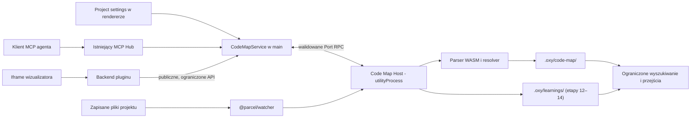
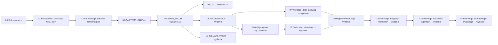

# Code Map — finalny plan funkcjonalności

> Implementation progress (2026-10-20): stages 00–12 implemented; release-validation gates remain open. Continue with
> stage 13 using [status.md](status.md) and [the storage report](results/2026-10-20-learning-storage.md).
> Stage 12 includes the core manager, worktree archives, explicit promotion and evidence observation. Stage 10 includes an
> offline harness and frozen corpus; paid evaluation remains deferred and the benefit gate is unverified. Stages
> 13–14 remain. The owner requested autonomous continuation and a push after each stage on 2026-10-20.

> **Planning baseline (historical):** plan gotowy do realizacji, implementacja nierozpoczęta. Wersja planu: 2026-10-19 (stan kodu: Oxytocin
> 0.9.10, plugin API 0.1.10). Ten dokument zastępuje wcześniejsze trzy rundy researchu (są w historii Gita, commit
> `eaa222d` i wcześniejsze) i jest jedynym źródłem prawdy dla Code Map.

**Code Map** to włączana per projekt funkcja Oxytocin: po jej włączeniu Oxytocin tworzy w projekcie katalog `.oxy/`
(domyślnie dopisany do `.gitignore`) i utrzymuje w nim **deterministyczny graf kodu projektu** — foldery, pliki, symbole,
importy, wywołania i dziedziczenie. Graf buduje własny kod Oxytocin (parsery, bez AI), w tle, i sam go aktualizuje, póki
aplikacja działa. Agenci (Claude Code, Codex, Gemini CLI…) korzystają z mapy przez plik `.oxy/code-map/MAP.md` i narzędzia
MCP Oxytocin, żeby szybciej i taniej znajdować właściwy kod, a wbudowany plugin **Code Map Visualizer** pozwala ten sam
graf oglądać. W ostatniej fazie dochodzą **learnings** — krótkie, poparte dowodami wnioski zapisywane przez agentów.

Nazwa produktu: **Code Map**; opis marketingowy: „Code Map for agents”. Cały interfejs, `MAP.md`, logi, komunikaty i
kod są po angielsku (reguła repozytorium); po polsku jest wyłącznie ta dokumentacja planu.

---

## Spis treści

1. [Jak pracować z tym planem (instrukcja dla agenta)](#1-jak-pracować-z-tym-planem-instrukcja-dla-agenta)
2. [Problem i wizja](#2-problem-i-wizja)
3. [Użytkownicy i scenariusze](#3-użytkownicy-i-scenariusze)
4. [Zakres](#4-zakres)
5. [Wymagania funkcjonalne](#5-wymagania-funkcjonalne)
6. [Wymagania niefunkcjonalne](#6-wymagania-niefunkcjonalne)
7. [Reguły biznesowe](#7-reguły-biznesowe)
8. [Projekt systemu](#8-projekt-systemu)
9. [Decyzje właściciela i decyzje projektowe](#9-decyzje-właściciela-i-decyzje-projektowe)
10. [Ryzyka](#10-ryzyka)
11. [Metryki sukcesu](#11-metryki-sukcesu)
12. [Etapy realizacji](#12-etapy-realizacji)
13. [Słownik](#13-słownik)
14. [Źródła i atrybucja](#14-źródła-i-atrybucja)

---

## 1. Jak pracować z tym planem (instrukcja dla agenta)

Plan jest podzielony na **etapy** (`etap-00-…md` … `etap-14-…md`). Każdy etap kończy się stanem, który można zbudować,
przetestować, zacommitować i — jeśli etap jest oznaczony jako wydanie — wydać. Agent realizujący Code Map postępuje tak:

1. Przeczytaj `CLAUDE.md` w katalogu głównym repozytorium (reguły właściciela są nadrzędne wobec tego planu).
2. Przeczytaj **ten plik w całości** — zawiera wymagania, kontrakty i projekt wspólny dla wszystkich etapów.
3. Znajdź w [tabeli etapów](#12-etapy-realizacji) pierwszy etap ze statusem „do zrobienia”, którego zależności są
   „zrobione”. Przeczytaj jego plik w całości. Realizuj **tylko ten etap**.
4. Zanim zaczniesz pisać kod, sprawdź, czy ścieżki i nazwy z pliku etapu nadal istnieją w kodzie (zostały
   zweryfikowane przy 0.9.10). Jeśli kod się przesunął, najpierw popraw plik etapu (osobny commit `docs(code-map): …`).
5. Wykonaj zadania etapu w podanej kolejności, z testami opisanymi w etapie. Każda zmiana zachowania ma test
   (unit/integration), każda zmiana widoczna dla użytkownika — test E2E.
6. Odhacz checklistę „Kryteria ukończenia” w pliku etapu. Wyniki pomiarów zapisz w `results/` (patrz niżej).
7. Zaktualizuj status etapu w tabeli w sekcji 12 tego pliku (w tym samym commicie, który kończy etap).
8. Commit i push zgodnie z regułami repozytorium (sekcja 12.2).

Zasady rozstrzygania wątpliwości:

- **Kolejność ważności:** `CLAUDE.md` → ten plik → plik etapu. Jeśli plik etapu przeczy temu plikowi, wygrywa ten plik
  i trzeba poprawić plik etapu.
- **Liczby w tym planie to cele inżynierskie, nie zmierzone wyniki.** Zastępuje je dopiero plik w `results/`.
- Jeżeli decyzja nie wynika z planu ani z kodu, a jest decyzją produktową — zapytaj właściciela; nie zgaduj.
  Decyzje techniczne o oczywistym rozwiązaniu podejmuj sam i zapisz je w pliku etapu.
- Nie kopiuj kodu, zapytań Tree-sitter ani tekstów z Trail-Code (to wyłącznie referencja zachowania, licencja MIT,
  atrybucja w sekcji 14).

**Pliki wyników.** Każdy pomiar trafia do `docs/planned-features/code-map/results/<RRRR-MM-DD>-<temat>.md` z datą,
rewizją repozytorium, maszyną, wersjami Electron/Node, fixture, surowymi liczbami i przypadkami nieudanymi.

---

## 2. Problem i wizja

### 2.1 Problem

Każda nowa sesja agenta zaczyna bez wiedzy o repozytorium. Zanim cokolwiek zmieni, agent wydaje wywołania narzędzi i
tokeny na orientację: listuje katalogi, grepuje nazwy, otwiera pliki tylko po to, żeby zobaczyć eksporty, ręcznie
śledzi importy i zgaduje, kto woła daną funkcję. Ta praca powtarza się w każdej sesji i w każdym równoległym agencie,
rośnie z rozmiarem repozytorium, a przeoczeni wywołujący kończą się zepsutymi zmianami.

Oxytocin zna już projekty użytkownika, obserwuje ich pliki, hostuje terminale agentów i uruchamia serwer MCP, z którym
agenci rozmawiają. Jest we właściwym miejscu, żeby raz zbudować mapę kodu i dać ją każdemu agentowi.

### 2.2 Wizja

> Włącz **Code Map** dla projektu, a Oxytocin utrzymuje w jego katalogu `.oxy` deterministyczną, zawsze aktualną mapę
> kodu. Agenci znajdują właściwy kod mniejszą liczbą, lepiej celowanych wyszukiwań, a Ty możesz tę samą mapę oglądać.

### 2.3 Cele biznesowe

| ID  | Cel                                                                                                                             |
| --- | ------------------------------------------------------------------------------------------------------------------------------- |
| G1  | Niższy koszt eksploracji agentów (wywołania narzędzi, tokeny wejściowe, czas) w zmapowanych projektach, bez spadku poprawności. |
| G2  | Zerowy koszt konfiguracji: jeden przełącznik na projekt; bez klucza API, kosztu modeli, instalowania CLI, sieci; działa offline. |
| G3  | Nigdy nie przeszkadzać: indeksowanie w tle bez odczuwalnych opóźnień terminali, edytora i Gita.                                 |
| G4  | Pomoc w rozumieniu kodu (onboarding, przegląd zmian agentów) przez wizualny eksplorator tej samej mapy.                         |
| G5  | Wyróżnik Oxytocin względem zwykłego terminala: projekt staje się „gotowy dla agentów” jednym kliknięciem.                        |

---

## 3. Użytkownicy i scenariusze

| Persona                                      | Potrzeba                                                                                                 |
| -------------------------------------------- | -------------------------------------------------------------------------------------------------------- |
| P1 — programista intensywnie używający agentów (główna) | Codziennie uruchamia jednego lub kilku agentów na swoich repozytoriach; chce szybszych, tańszych i trafniejszych sesji. |
| P2 — programista w nieznanym repozytorium     | Musi szybko zrozumieć strukturę, punkty wejścia i zależności.                                            |
| P3 — recenzent pracy agentów                  | Używa Changes, Task lub Ensemble; chce widzieć, czego dotyka zmiana i co może od niej zależeć.           |

Scenariusze, które funkcja musi obsłużyć od początku do końca:

- **S1 — Włączenie.** P1 otwiera *Project settings → Code Map*, włącza przełącznik i potwierdza. W potwierdzeniu pole
  **Keep `.oxy` out of Git** jest domyślnie zaznaczone; Oxytocin tworzy `.oxy/`, dopisuje go do `.gitignore` i pokazuje
  postęp. Po około minucie (typowe repozytorium) mapa jest gotowa. P1 commituje linię w `.gitignore`.
- **S2 — Sesja agenta.** P1 uruchamia Claude Code w terminalu Oxytocin. Agent czyta `.oxy/code-map/MAP.md` albo woła
  `oxy_find_code`, od razu trafia do właściwych plików, przed zmianą funkcji sprawdza wywołujących przez
  `oxy_code_relations` i czyta tylko potrzebny kod.
- **S3 — Aktualność.** Agent edytuje dziesięć plików, P1 przełącza gałąź, `git pull` dodaje pakiet. Mapa nadąża za każdą
  zmianą w tle; zapytanie agenta tuż po edycji widzi tę edycję.
- **S4 — Eksploracja.** P2 otwiera **Code Map** z projektu, widzi foldery jako klastry z zależnościami, wchodzi w folder,
  zaznacza plik, widzi jego importy i importujących, otwiera symbol w edytorze.
- **S5 — Przegląd.** P3 włącza nakładkę *Changes* wizualizatora: niezacommitowane zmiany (lub zmiany zadania) są
  podświetlone razem z zaindeksowanym kodem, który potencjalnie od nich zależy.
- **S6 — Wyłączenie.** P1 wyłącza Code Map. Praca w tle ustaje, narzędzia agentów przestają odpowiadać dla tego projektu,
  a dane `.oxy/code-map` można usunąć jednym przyciskiem.

---

## 4. Zakres

**W zakresie** (produkt = wszystkie etapy 0–14):

- Włączanie per projekt, katalog `.oxy/`, obsługa `.gitignore` (domyślnie włączona, można wyłączyć).
- Deterministyczny graf plików, folderów, symboli i relacji, budowany przez kod Oxytocin (bez AI).
- Pełne wsparcie (symbole, importy, wywołania) dla **JavaScript/TypeScript i C#** w pierwszych wydaniach; Go, Java i
  Python później; każdy inny plik tekstowy jako węzeł pliku.
- Budowa w tle i ciągła aktualizacja (watcher + okresowa rekoncyliacja + sprawdzenie świeżości przy zapytaniu).
- Dostęp agentów przez `MAP.md` i narzędzia MCP istniejącego MCP Hub; instrukcje dla agentów do skopiowania.
- Wizualizator jako wbudowany plugin, z publicznym API pluginów dla mapy.
- Status, diagnostyka i sterowanie w ustawieniach projektu.
- Osobne mapy dla worktree Ensemble.
- Learnings (ostatnie etapy): agenci proponują wnioski z dowodami, Oxytocin przechowuje je w `.oxy/learnings/`, sprawdza,
  czy nadal obowiązują, i zwraca pasujące razem z kontekstem zadania. To jedyna część, której treść pochodzi od
  agentów; sama mapa pozostaje deterministyczna.

**Później (na żądanie):** Rust, PHP i inne języki; współdzielenie learnings w zespole wykraczające poza commitowanie
`.oxy` przy wyłączonej opcji Gita.

**Poza zakresem:**

- Jakiekolwiek użycie AI/LLM przez samo Oxytocin przy budowie lub aktualizacji mapy i learnings (podsumowania,
  embeddingi, klasyfikacja, wywołania modeli w tle). Learnings piszą agenci użytkownika przez MCP.
- Wysyłanie kodu lub mapy gdziekolwiek; synchronizacja zespołowa; usługi chmurowe.
- Uruchamianie kodu projektu, skryptów budowania, menedżerów pakietów i serwerów językowych (LSP).
- Indeksowanie niezapisanych buforów edytora; indeksowanie przy zamkniętym Oxytocin.
- Instalowanie hooków w klientach agentów albo edycja `CLAUDE.md`/`AGENTS.md` bez jawnej akcji użytkownika.
- Gwarancja, że graf jest kompletnym grafem wywołań w czasie działania programu.

---

## 5. Wymagania funkcjonalne

Priorytety: **M** = musi (blokuje wydanie etapu), **S** = powinno, **C** = może. Kolumna „Etap” wskazuje plik etapu,
który wymaganie realizuje.

### 5.1 Włączanie i cykl życia (FR-EN)

| ID       | Wymaganie                                                                                                                                                                                                      | Prio | Etap |
| -------- | -------------------------------------------------------------------------------------------------------------------------------------------------------------------------------------------------------------- | ---- | ---- |
| FR-EN-1  | Ustawienia projektu mają zakładkę **Code Map** z przełącznikiem **Enable Code Map**. Dla istniejących i nowych projektów Code Map jest wyłączone, dopóki użytkownik go nie włączy.                              | M    | 04   |
| FR-EN-2  | Włączenie pokazuje jednorazowe potwierdzenie z opisem skutków: utworzenie `.oxy/` w projekcie, dopisanie `/.oxy/` do `.gitignore` (pole **Keep `.oxy` out of Git**, domyślnie zaznaczone), indeksowanie zapisanych plików w tle. | M    | 04   |
| FR-EN-3  | Włączenie natychmiast startuje pierwszą budowę; nie jest potrzebna sesja agenta.                                                                                                                               | M    | 04   |
| FR-EN-4  | **Pause updates / Resume updates** zatrzymuje i wznawia pracę w tle bez usuwania danych; w czasie pauzy agenci dostają wyłącznie jawnie nieaktualne odpowiedzi.                                                | S    | 04   |
| FR-EN-5  | **Rebuild** odrzuca cache ekstrakcji i buduje od zera; można go anulować.                                                                                                                                      | M    | 04   |
| FR-EN-6  | Wyłączenie zatrzymuje całą pracę i obserwację plików projektu, narzędzia agentów odmawiają obsługi tego projektu, a `.oxy/code-map/` zostaje (szybkie ponowne włączenie).                                       | M    | 04   |
| FR-EN-7  | **Delete map data** usuwa `.oxy/code-map/` (i `.oxy/`, jeśli poza plikami Oxytocin jest pusty). Nigdy nie dotyka plików poza `.oxy/`.                                                                           | M    | 04   |
| FR-EN-8  | Ustawienie jest zapisane w ustawieniach projektu (`settings.codeMap`) i przetrwa restart; po restarcie włączone projekty przechodzą rekoncyliację, zanim odpowiedzą agentom.                                    | M    | 04   |
| FR-EN-9  | Usunięcie projektu z Oxytocin zatrzymuje jego Code Map. `.oxy/` zostaje na dysku (należy do folderu użytkownika); dialog usuwania to mówi.                                                                     | M    | 04   |
| FR-EN-10 | Zmiana katalogu głównego projektu zatrzymuje starą mapę i buduje nową w nowym katalogu.                                                                                                                        | M    | 04   |

### 5.2 Katalog `.oxy` i Git (FR-DIR)

| ID       | Wymaganie                                                                                                                                                                                                                                                       | Prio | Etap   |
| -------- | --------------------------------------------------------------------------------------------------------------------------------------------------------------------------------------------------------------------------------------------------------------- | ---- | ------ |
| FR-DIR-1 | Oxytocin tworzy `<root>/.oxy/` z `.gitignore`, `README.md` (co to za folder, że można go bezpiecznie usunąć) i `code-map/`.                                                                                                                                       | M    | 01     |
| FR-DIR-2 | **Keep `.oxy` out of Git** jest domyślnie włączone. Wtedy w projekcie Gita włączenie dopisuje `/.oxy/` (z linią komentarza) do `<root>/.gitignore` (tworząc plik w razie potrzeby), chyba że równoważny wpis już istnieje; `.oxy/.gitignore` zawiera `*`. Zachowana treść, końce linii, BOM i końcowy znak nowej linii. | M    | 01, 04 |
| FR-DIR-3 | Oxytocin nigdy nie edytuje `.gitignore` w worktree Ensemble (ich `.oxy/` jest zawsze w całości ignorowany przez `.oxy/.gitignore`) ani w żadnym folderze poza katalogiem głównym włączonego projektu.                                                          | M    | 01, 07 |
| FR-DIR-4 | Oxytocin nigdy nie pisze poza `.oxy/`, z wyjątkiem wpisu w `.gitignore` (FR-DIR-2/FR-DIR-9) i — na jawne żądanie — bloku instrukcji (FR-AG-7).                                                                                                                   | M    | 01     |
| FR-DIR-5 | Mapa nigdy nie zawiera ścieżek absolutnych, nazw użytkowników ani maszyn, znaczników czasu plików ani sekretów; ścieżki są względne wobec projektu, w formacie POSIX.                                                                                            | M    | 01, 03 |
| FR-DIR-6 | Zapisy w `.oxy/` nie wywołują odświeżania statusu Gita Oxytocin, watchera plików ani pętli przebudowy Code Map.                                                                                                                                                 | M    | 01     |
| FR-DIR-7 | Gdy `.oxy/` nie da się utworzyć ani zapisać (folder tylko do odczytu, uprawnienia), Code Map pokazuje stan błędu z przyczyną; nie pisze po cichu gdzie indziej.                                                                                                  | M    | 01, 04 |
| FR-DIR-8 | Daną `.oxy/code-map/` zapisuje naraz tylko jedna instancja Oxytocin; druga (np. build deweloperski) czyta ją albo informuje, że właścicielem jest inna instancja.                                                                                                 | S    | 01     |
| FR-DIR-9 | Użytkownik może wyłączyć **Keep `.oxy` out of Git** w potwierdzeniu i w zakładce. Wtedy Oxytocin nie dodaje wpisu w katalogu głównym, proponuje usunięcie dokładnie tego wpisu, który wcześniej dodał (tylko jeśli jest niezmieniony), a `.oxy/.gitignore` ignoruje tylko pliki lokalne maszyny (cache, lock, manifest, pliki tymczasowe), więc `graph.json`, `MAP.md` i learnings można commitować. Zakładka ostrzega, że pliki mapy pojawią się w Changes i commitach. Ponowne włączenie przywraca FR-DIR-2. | M    | 01, 04 |

### 5.3 Budowa grafu (FR-BLD)

| ID        | Wymaganie                                                                                                                                                                                                                                         | Prio | Etap   |
| --------- | ------------------------------------------------------------------------------------------------------------------------------------------------------------------------------------------------------------------------------------------------- | ---- | ------ |
| FR-BLD-1  | Budowa jest deterministyczna: te same zapisane pliki, ustawienia Code Map i wersja Oxytocin dają bajtowo identyczne `graph.json` i `MAP.md` na Windows, macOS i Linux, przy budowie od zera i przyrostowej.                                        | M    | 03     |
| FR-BLD-2  | Bez AI, sieci i uruchamiania kodu projektu. Pliki konfiguracyjne (`package.json`, `tsconfig.json`/`jsconfig.json`) są czytane wyłącznie jako dane.                                                                                                 | M    | 03     |
| FR-BLD-3  | Indeksowane pliki: zapisane pliki drzewa roboczego śledzone lub nieśledzone przez Gita (bez ignorowanych), a w folderach bez Gita — wszystkie pliki; minus wykluczenia wbudowane i użytkownika.                                                    | M    | 02     |
| FR-BLD-4  | Wykluczenia wbudowane: `.git`, `.oxy`, domyślne foldery z `git.ignoredFolders` (`node_modules`, `dist`, `build`, `out`…), pliki binarne, pliki ponad 2 MiB, pliki lock, prawdopodobne sekrety (`.env*`, `*.pem`, `*.key`, `id_rsa*`…).              | M    | 02     |
| FR-BLD-5  | Użytkownik może dodać wzorce wykluczeń (globy względne wobec projektu) w zakładce Code Map.                                                                                                                                                        | M    | 02, 04 |
| FR-BLD-6  | Węzły: grupy folderów, pliki (wszystkie indeksowane, z językiem i rozmiarem), a dla TS/JS i C# deklaracje z sekcji 8.8 (funkcje, metody, klasy, interfejsy, typy, enumy, przestrzenie nazw, właściwości…) z nazwą, rodzajem, sygnaturą, eksportem/widocznością i zakresem w źródle. Projekty C# (`.csproj`) i solucje są węzłami-grupami. | M    | 03, 05 |
| FR-BLD-7  | Relacje: `contains` (folder → plik → symbol), `imports` (plik → plik, z flagą type-only), `exports`/re-eksporty, `calls`, `extends`, `implements`, `references` — tam, gdzie da się je statycznie rozwiązać.                                         | M    | 03, 05 |
| FR-BLD-8  | Każda relacja zapisuje sposób rozwiązania (`syntax`, `binding`, `heuristic`) i miejsce (linia w źródle). Nierozwiązane importy/wywołania są liczone i listowane, nigdy zgadywane w błędną krawędź.                                                 | M    | 03     |
| FR-BLD-9  | Importy TS/JS: ścieżki względne, rozszerzenia i `index`, `tsconfig` `paths`/`baseUrl`, pakiety workspace npm w projekcie. C#: typy przez przestrzenie nazw, `using`/`global using`/implicit usings, `ProjectReference`, typy partial. Pakiety zewnętrzne (npm, NuGet) jako węzły `package`, bez indeksowania ich kodu. | M    | 03, 05 |
| FR-BLD-10 | Raport pokrycia: pliki zaindeksowane, pominięte (z powodem), w nieobsługiwanym języku i nieudane; liczba nierozwiązanych relacji.                                                                                                                 | M    | 03     |
| FR-BLD-11 | Błąd składni w pliku zachowuje ostatnie poprawne symbole tego pliku oznaczone jako nieaktualne i jest raportowany; nie psuje całej budowy.                                                                                                        | S    | 03     |
| FR-BLD-12 | Limity ochronne (początkowo: 50 000 plików, 500 000 symboli, 2 000 000 krawędzi, 512 MiB danych mapy) zatrzymują budowę w widocznym stanie „limit reached — add exclusions” zamiast po cichu niepełnej mapy.                                     | M    | 03     |
| FR-BLD-13 | Go i Java z symbolami, importami i wywołaniami; Python z symbolami, importami i prostymi wywołaniami — każdy z własnymi fixture i opisem pokrycia.                                                                                                | S    | 11     |
| FR-BLD-14 | UI, `MAP.md` i `oxy_code_map_status` pokazują poziom wsparcia per język (Files / Symbols / Imports / Calls).                                                                                                                                     | M    | 03, 04 |

### 5.4 Aktualizacje w tle (FR-UPD)

| ID       | Wymaganie                                                                                                                                                                                                                                          | Prio | Etap |
| -------- | -------------------------------------------------------------------------------------------------------------------------------------------------------------------------------------------------------------------------------------------------- | ---- | ---- |
| FR-UPD-1 | Całe indeksowanie działa w osobnym procesie Code Map Host z obniżonym priorytetem systemowym, w ograniczonych partiach; proces main, terminale i renderer nigdy nie parsują kodu.                                                                   | M    | 01   |
| FR-UPD-2 | Watcher plików wyłapuje zapisy, utworzenia, usunięcia i zmiany nazw; zmiany są debounce'owane (początkowo: 300 ms ciszy, maks. 2 s opóźnienia) i parsowane są tylko zmienione pliki.                                                                | M    | 02   |
| FR-UPD-3 | Okresowa rekoncyliacja porównuje folder z mapą i naprawia to, co watcher przeoczył: co 60 s dla aktywnego projektu i projektów z działającymi terminalami, co 10 min dla pozostałych włączonych, pełny audyt hashy co 30 min i przy starcie aplikacji. | M    | 02   |
| FR-UPD-4 | Przełączenie gałęzi, `git pull`, stash/reset i masowe zmiany zlewają się w jedną rekoncyliację zamiast tysięcy aktualizacji pojedynczych plików.                                                                                                   | M    | 02   |
| FR-UPD-5 | Rekoncyliacja startuje też przy starcie aplikacji, przy fokusie okna po uśpieniu/wybudzeniu, po błędzie/przepełnieniu watchera i po zmianie `.gitignore`, `tsconfig`/`package.json` albo wykluczeń Code Map.                                       | M    | 02   |
| FR-UPD-6 | Jedna budowa na checkout naraz; między projektami aktywny projekt idzie pierwszy. Trwająca budowa nie jest restartowana przy każdym naciśnięciu klawisza; nowsze zmiany czekają na następny przebieg.                                               | M    | 02   |
| FR-UPD-7 | Aktualizacje nigdy nie pokazują toastów ani nie kradną fokusu. Postęp i błędy widać tylko w statusie Code Map (zakładka ustawień, wskaźnik przy projekcie).                                                                                        | M    | 04   |
| FR-UPD-8 | Zapytanie agenta najpierw upewnia się, że zaobserwowane zmiany są w mapie, czekając maks. 2 s; w przeciwnym razie dostaje jawną odpowiedź „updating” albo nieaktualną — nigdy „brak wyników” z niepełnej mapy.                                     | M    | 06   |

### 5.5 Dostęp agentów (FR-AG)

| ID      | Wymaganie                                                                                                                                                                                                                             | Prio | Etap   |
| ------- | ------------------------------------------------------------------------------------------------------------------------------------------------------------------------------------------------------------------------------------- | ---- | ------ |
| FR-AG-1 | `.oxy/code-map/MAP.md` to deterministyczny, ograniczony (początkowo 32 KiB) przegląd: jak używać mapy, języki i pokrycie, drzewo folderów z rolami i liczbami, punkty wejścia, najczęściej importowane pliki i publiczne API kluczowych plików. | M    | 03     |
| FR-AG-2 | Istniejący MCP Hub Oxytocin udostępnia pięć narzędzi tylko do odczytu dla projektów z Code Map: `oxy_code_map_status`, `oxy_repo_map`, `oxy_find_code`, `oxy_file_outline`, `oxy_code_relations` (sekcja 8.7).                       | M    | 06     |
| FR-AG-3 | Każda odpowiedź narzędzia niesie świeżość (generacja, flaga stale, oczekujące pliki), pokrycie i informację o obcięciu; wyniki są ograniczone (domyślnie 8000 znaków, maks. 24 000).                                                    | M    | 06     |
| FR-AG-4 | Narzędzia wybierają projekt/checkout z terminala agenta albo z jawnego `cwd`/`project`; nigdy nie wracają do projektu aktywnego w UI. Agenci w worktree Ensemble dostają mapę swojego worktree.                                       | M    | 06, 07 |
| FR-AG-5 | Nowe sesje MCP dostają krótki opis narzędzi; opisy narzędzi same się tłumaczą dla już połączonych sesji.                                                                                                                              | M    | 06     |
| FR-AG-6 | **Copy agent instructions** kopiuje krótką regułę: najpierw przeczytaj `MAP.md`, używaj narzędzi, sprawdzaj świeżość, w razie braku odpowiedzi wróć do zwykłego wyszukiwania.                                                           | M    | 04     |
| FR-AG-7 | **Add to CLAUDE.md / AGENTS.md** wstawia (a **Remove** usuwa) blok instrukcji ograniczony znacznikami w wybranym pliku. Tylko na jawne żądanie, nigdy automatycznie.                                                                  | S    | 07     |
| FR-AG-8 | Tekst źródłowy z mapy to dane, nigdy instrukcje; logi narzędzi zapisują czasy i liczby, nie treść kodu.                                                                                                                              | M    | 06     |

### 5.6 Wizualizator (FR-VIS)

| ID        | Wymaganie                                                                                                                                                                                              | Prio | Etap |
| --------- | ------------------------------------------------------------------------------------------------------------------------------------------------------------------------------------------------------ | ---- | ---- |
| FR-VIS-1  | Wbudowany plugin **Code Map Visualizer** otwiera się jako zakładka obszaru roboczego lub panel boczny z menu kontekstowego projektu, palety poleceń („Code Map: Open”) i zakładki Code Map.           | M    | 09   |
| FR-VIS-2  | **Overview**: foldery/pakiety jako klastry z zagregowanymi zależnościami importów (liczba na krawędzi); rozwinięcie klastra do podfolderów i plików.                                                    | M    | 09   |
| FR-VIS-3  | **Neighborhood**: zaznaczony plik lub symbol z relacjami wchodzącymi i wychodzącymi, głębokość 1–3, filtr po typie relacji i sposobie rozwiązania.                                                      | M    | 09   |
| FR-VIS-4  | **File**: symbole pliku (outline), jego importy i importujący.                                                                                                                                         | M    | 09   |
| FR-VIS-5  | **Search** po ścieżce pliku lub nazwie symbolu, z nawigacją klawiaturą; wybór wyniku skupia go w grafie.                                                                                               | M    | 09   |
| FR-VIS-6  | Panel szczegółów: ścieżka, rodzaj, sygnatura, zakres, liczby wejść/wyjść i dowody relacji; **Open in editor** skacze do dokładnego miejsca w edytorze Oxytocin.                                       | M    | 09   |
| FR-VIS-7  | Widok podąża za aktualizacjami mapy bez resetowania układu istniejących węzłów i czysto przełącza się przy zmianie projektu/checkoutu.                                                                 | M    | 09   |
| FR-VIS-8  | Duże mapy pozostają używalne: widok prosi o ograniczone wycinki (domyślnie 150 węzłów / 300 krawędzi, twardo 500 / 1000) i mówi, co pominięto; nigdy nie renderuje całego grafu dużego projektu.        | M    | 08, 09 |
| FR-VIS-9  | Widok listy dostępny z klawiatury pokazuje ten sam wycinek; typy krawędzi różnią się stylem linii i etykietą, nie tylko kolorem; motywy jasny/ciemny z tokenów Oxytocin.                                | M    | 09   |
| FR-VIS-10 | **Changes overlay**: podświetla pliki z niezacommitowanymi zmianami (lub zmianami wybranego worktree Ensemble) i ich potencjalnie zależny zaindeksowany kod.                                           | S    | 10   |
| FR-VIS-11 | **Impact view** dla symbolu lub pliku: „Potential dependents in indexed code”, pogrupowane po folderach, z jasną informacją, że lista nie jest wyczerpująca.                                            | S    | 10   |
| FR-VIS-12 | Eksport bieżącego widoku jako SVG/PNG.                                                                                                                                                                 | C    | 10   |
| FR-VIS-13 | Wizualizator działa wyłącznie przez publiczne API pluginów; agenci i indeksowanie działają dalej po wyłączeniu pluginu.                                                                               | M    | 08, 09 |

### 5.7 Status i diagnostyka (FR-ST)

| ID      | Wymaganie                                                                                                                                                                                                                         | Prio | Etap |
| ------- | --------------------------------------------------------------------------------------------------------------------------------------------------------------------------------------------------------------------------------- | ---- | ---- |
| FR-ST-1 | Zakładka Code Map pokazuje stan (`Off`, `Indexing n%`, `Ready`, `Updating`, `Paused`, `Degraded`, `Error`, `Limit reached`), czas ostatniej aktualizacji, liczby (pliki, symbole, relacje), pokrycie per język, rozmiar mapy i dostęp agentów (MCP on/off). | M    | 04   |
| FR-ST-2 | Mały wskaźnik przy projekcie na pasku bocznym pokazuje Indexing/Ready/Error dla włączonych projektów; tooltip z podsumowaniem; kliknięcie otwiera zakładkę Code Map.                                                            | S    | 04   |
| FR-ST-3 | Diagnostyka listuje pominięte/nieudane pliki i nierozwiązane importy (ograniczona lista, przycisk „copy” do zgłoszeń błędów), bez powtarzanych powiadomień.                                                                       | S    | 04   |
| FR-ST-4 | Zdrowie i restarty Code Map Host widać w istniejącym statusie hostów (About/diagnostyka).                                                                                                                                       | M    | 01   |

### 5.8 Worktree i wiele checkoutów (FR-WT)

| ID      | Wymaganie                                                                                                                                                       | Prio | Etap |
| ------- | --------------------------------------------------------------------------------------------------------------------------------------------------------------- | ---- | ---- |
| FR-WT-1 | Worktree Ensemble projektu z Code Map dostają własne `.oxy/code-map/` budowane z plików worktree, ze wspólnymi wykluczeniami projektu.                           | M    | 07   |
| FR-WT-2 | Mapa worktree powstaje, gdy worktree jest gotowy, i zatrzymuje się, gdy zostaje usunięty; dla worktree nigdy nie jest zwracana mapa głównego projektu.            | M    | 07   |
| FR-WT-3 | Wizualizator ma selektor checkoutu (główny folder, aktywne worktree).                                                                                          | S    | 10   |

### 5.9 Learnings — samouczący się kontekst (FR-LRN)

| ID       | Wymaganie                                                                                                                                                                                                         | Prio | Etap |
| -------- | ----------------------------------------------------------------------------------------------------------------------------------------------------------------------------------------------------------------- | ---- | ---- |
| FR-LRN-1 | Tryb **Learnings** per projekt: Off, Review before reuse, Automatic (domyślnie Review po włączeniu Code Map; zmiana to preferencja użytkownika).                                                                  | M    | 12   |
| FR-LRN-2 | Agenci zgłaszają krótkie learnings (constraint, decision, pitfall, validation, failed approach) z kotwicami dowodów przez `oxy_propose_learning`; użytkownik może dodawać własne.                                 | M    | 12, 13 |
| FR-LRN-3 | Oxytocin sam waliduje zakres i dowody (hashe zakotwiczonych plików), deduplikuje, wykrywa jawne konflikty i zapisuje wersjonowane rekordy w `.oxy/learnings/`.                                                    | M    | 12   |
| FR-LRN-4 | `oxy_task_context` zwraca ograniczone wskaźniki kodu, mały wycinek relacji i do trzech pasujących learnings z pochodzeniem, stanem przeglądu i dowodami; `oxy_learning_feedback` zapisuje used/irrelevant/outdated/incorrect. | M    | 13   |
| FR-LRN-5 | Learning, którego dowody się zmieniły, przestaje być używany do ponownej walidacji; learnings z worktree zostają w nim, dopóki użytkownik ich nie awansuje.                                                       | M    | 12   |
| FR-LRN-6 | Menedżer **Learnings** w rdzeniu (wyszukiwanie, szczegóły, akceptacja, odrzucenie, edycja jako nowa rewizja, zastąpienie, usunięcie, eksport, forget all) działa bez wizualizatora.                               | M    | 12   |
| FR-LRN-7 | **Rebuild** i **Delete map data** nigdy nie usuwają learnings; **Forget all learnings** to osobna, potwierdzana akcja.                                                                                           | M    | 12   |
| FR-LRN-8 | Wizualizator pokazuje learnings połączone z ich kotwicami w kodzie, wizualnie odróżnione od deterministycznej struktury i według stanu przeglądu.                                                                | S    | 14   |
| FR-LRN-9 | Żadnego przeszukiwania transkryptów i wywołań modeli w tle: learnings pochodzą wyłącznie z jawnych wywołań narzędzi przez agentów i od użytkownika.                                                              | M    | 12–14 |

---

## 6. Wymagania niefunkcjonalne

Cele inżynierskie do potwierdzenia w etapie 0 i w pomiarach etapów 04, 06 i 09.

| ID     | Obszar           | Wymaganie                                                                                                                                                                                  |
| ------ | ---------------- | ------------------------------------------------------------------------------------------------------------------------------------------------------------------------------------------ |
| NFR-1  | Wydajność        | Budowa od zera repozytorium TS/JS z 10 000 plików poniżej 30 s na udokumentowanej maszynie z Windows; repozytorium Oxytocin poniżej 10 s.                                                   |
| NFR-2  | Świeżość         | Zapisana edycja jednego pliku jest w mapie (zapytania i `graph.json`) w ciągu 2 s (p95) na fixture 10 000 plików.                                                                           |
| NFR-3  | Opóźnienie zapytań | Ciepłe zapytania MCP p95 poniżej 200 ms, bez wymaganego odświeżenia.                                                                                                                     |
| NFR-4  | Nieprzeszkadzanie | Opóźnienie wejścia terminala i odświeżania statusu Gita p95 pogarsza się maks. o 10% podczas budowy od zera; brak blokowania procesu main; w spoczynku CPU poniżej 1% jednego rdzenia (średnio z 5 min). |
| NFR-5  | Pamięć           | Code Map Host poniżej 512 MiB pamięci rezydentnej na fixture 10 000 plików; zwalnia dane projektu po jego wyłączeniu.                                                                     |
| NFR-6  | Dysk             | Dane mapy typowo poniżej 5% rozmiaru indeksowanego kodu, twardy limit 512 MiB na checkout; wpisy cache usuniętych plików są czyszczone.                                                    |
| NFR-7  | Determinizm      | Bajtowo identyczne wyniki między uruchomieniami, platformami (separatory ścieżek, CRLF/LF, systemy plików bez rozróżniania wielkości liter), budową od zera i przyrostową, kolejnością enumeracji. |
| NFR-8  | Niezawodność     | Zabicie hosta lub aplikacji w trakcie budowy nigdy nie zostawia uszkodzonego `graph.json`; ostatnia dobra mapa pozostaje czytelna; uszkodzona lub w starym schemacie mapa jest automatycznie przebudowywana. |
| NFR-9  | Prywatność       | Wszystko zostaje na maszynie. Zero telemetrii kodu i mapy. Odpowiedzi dla agenta mogą trafić do dostawcy jego modelu — teksty UI nie mogą obiecywać inaczej.                              |
| NFR-10 | Bezpieczeństwo   | Bez uruchamiania kodu projektu; ścieżki zawarte w projekcie (symlinki/junctions wychodzące poza katalog główny nie są śledzone); prawdopodobne sekrety nigdy nie są czytane; dostęp pluginów wymaga uprawnienia. |
| NFR-11 | Platformy        | Windows 11 główny; macOS i Linux wspierane. Spakowane buildy działają offline z dołączonymi parserami, bez toolchainu kompilatora.                                                        |
| NFR-12 | Dostępność       | Wizualizator obsługiwany klawiaturą (widok listy), wystarczający kontrast w obu motywach, brak kodowania wyłącznie kolorem.                                                               |
| NFR-13 | Licencje         | Wszystkie nowe zależności zgodne z MIT (`npm run licenses:check`) i wpisane w `THIRD_PARTY_NOTICES.md`; żadnego kodu, zapytań ani tekstów z Trail-Code.                                   |
| NFR-14 | Język            | Cały tekst UI, `MAP.md`, logi i błędy po angielsku.                                                                                                                                       |

---

## 7. Reguły biznesowe

- **BR-1** Mapa to dane pochodne. Zawsze można ją usunąć i odbudować; nic w `.oxy/code-map/` nie jest źródłem prawdy.
- **BR-2** Oxytocin nigdy nie commituje, nie stage'uje ani nie pushuje niczego w imieniu Code Map. Edycja `.gitignore` to
  zwykła zmiana w drzewie roboczym, którą commituje użytkownik.
- **BR-3** „Ready” oznacza, że mapa odzwierciedla pliki widziane w ostatnim punkcie kontrolnym, a nie pełną wiedzę
  semantyczną. Brak krawędzi nigdy nie dowodzi, że kod jest nieużywany; UI i teksty narzędzi mówią
  „potential dependents in indexed code”.
- **BR-4** Bez feature flag: Code Map jest dostępne dla wszystkich od wydania zawierającego etap 04; przełącznik per
  projekt to preferencja użytkownika, nie mechanizm rolloutu.
- **BR-5** Żadnych deklaracji oszczędności w UI ani changelogu, dopóki nie zmierzy ich ewaluacja z etapu 10.
- **BR-6** Teksty dla agentów nie mogą zachęcać do pomijania czytania aktualnego źródła przed edycją.

---

## 8. Projekt systemu

### 8.1 Architektura procesów



Podział odpowiedzialności:

| Proces                     | Odpowiada za                                                                                                                                         | Nigdy nie robi                                    |
| -------------------------- | ---------------------------------------------------------------------------------------------------------------------------------------------------- | ------------------------------------------------- |
| **Main** (`src/main`)      | Ustawienia, autoryzowane tożsamości checkoutów, subskrypcje, nadzór hosta, orkiestracja, wskazówki aktywności (aktywny projekt, projekty z terminalami). | Nie parsuje kodu, nie czyta całego grafu, nie robi synchronicznego I/O. |
| **Code Map Host** (`src/code-map-host`, nowy) | Enumeracja, watcher, parsowanie, hashe treści, składanie grafu, indeksy wyszukiwania, cały I/O w `.oxy/`, później learnings.          | Nie uruchamia skryptów projektu ani LSP.          |
| **Renderer**               | Zakładka Code Map, wskaźnik przy projekcie; dostaje kompaktowy status i ograniczone wyniki przez walidowane IPC/preload.                             | Nie dostaje całego grafu.                         |
| **Plugin wizualizatora**   | Widoki; korzysta z publicznego API przez main.                                                                                                      | Nie czyta plików `.oxy` bezpośrednio.             |

Zasady wynikające z architektury Oxytocin (`CLAUDE.md`):

- Host Code Map jest nadzorowany przez `UtilityHost` (restart + health check), komunikacja przez `createPortRpc`
  (`src/shared/rpc`), wpis w `src/main/hosts/hosts.ts` (`HostEntry` + port inspect **9235**; 9230–9234 są zajęte).
  Host startuje leniwie, gdy pierwszy projekt włączy Code Map, i zatrzymuje się, gdy żaden nie jest włączony (wzorzec:
  Connections Host).
- Po starcie hosta main obniża jego priorytet: `os.setPriority(pid, os.constants.priority.PRIORITY_BELOW_NORMAL)`.
- Watcher: Code Map Host ma **własną** subskrypcję `@parcel/watcher`. To świadomy koszt pierwszego wydania —
  współdzielenie watchera Gita z Workspace Host wymagałoby uogólnienia własności, ignorów i obsługi projektów bez Gita.
  Nie tworzyć jednocześnie nowego kanału w Workspace Host i duplikatu w Code Map Host.
- Jeden zapisujący na checkout i początkowo jedna aktywna budowa w całym hoście. Priorytet: checkouty, o które pytają
  agenci, i aktywny projekt; potem pozostałe włączone, sprawiedliwie. Między partiami parsowania host oddaje pętlę
  zdarzeń (health pingi muszą przechodzić). Parser, który przekroczy watchdog, jest przerywany (worker lub restart hosta).
- Granice importów egzekwuje ESLint: host importuje tylko `@shared`; `src/shared` nie importuje electron/DOM/Node.
- Zod na każdej granicy IPC/RPC/plików; `Disposable` dla każdej subskrypcji i timera.
- Proces parsera to izolacja obciążenia, nie sandbox bezpieczeństwa systemu.

### 8.2 Ustawienia i trwałość

Kształt ustawień projektu (`ProjectSettingsSchema.codeMap`, opcjonalny — brak = wyłączone):

```ts
codeMap?: {
  enabled: boolean;            // brak = false
  excludedPaths?: string[];    // globy względne wobec projektu
  ignoreInGit?: boolean;       // brak = true: "Keep .oxy out of Git"
  memory?: { mode: 'off' | 'review' | 'automatic' }; // etap 12; brak = 'review' po włączeniu Code Map
}
```

- Pauza to stan runtime w v1: po restarcie włączone projekty wznawiają pracę i najpierw przechodzą rekoncyliację.
- Twarde limity zasobów są wewnętrznymi wartościami domyślnymi, dopóki pomiary nie uzasadnią kontrolek dla użytkownika.
- Status runtime i dane grafu **nie** trafiają do `projects.json`.
- Każda ścieżka zapisu ustawień projektu (draft w `project-settings-model.ts`) musi zachować `codeMap` — zapis innej
  zakładki nie może go zgubić (test).
- Checkout jest identyfikowany przez kanoniczny realny katalog główny + tożsamość projektu. Symbole używają ścieżek
  względnych POSIX, a tożsamość cache respektuje reguły wielkości liter systemu plików (łącznie z katalogami
  rozróżniającymi wielkość liter na Windows). Nie zmieniaj globalnie wielkości liter ścieżek. Junctions/symlinki są
  rozwiązywane przy sprawdzaniu zawierania; linki wychodzące poza katalog główny nie są śledzone.

### 8.3 Katalog `.oxy`

#### Układ

```text
<checkout root>/
├─ .gitignore                 ← jednorazowo dopisane "/.oxy/" (katalog główny projektu Gita, opcja włączona)
└─ .oxy/
   ├─ .gitignore              opcja włączona: "*" (wszystko); wyłączona: tylko pliki lokalne maszyny
   ├─ README.md               co to za folder; można go usunąć; jak wyłączyć Code Map
   ├─ code-map/
   │  ├─ manifest.json        wersja formatu, stan, liczby, pokrycie, czasy (jedyny plik ze znacznikami czasu)
   │  ├─ graph.json           deterministyczny graf
   │  ├─ MAP.md               deterministyczny, ograniczony przegląd dla agentów i ludzi
   │  ├─ cache/               rekordy ekstrakcji per plik, kluczowane hashem treści
   │  │  └─ <aa>/<sha256>.json
   │  └─ owner.lock           która instancja Oxytocin zapisuje tę mapę
   └─ learnings/              etapy 12–14
      ├─ learnings.json       trwałe, wersjonowane rekordy (nigdy nie usuwane przez Rebuild ani Delete map data)
      └─ local/               stan lokalny maszyny: liczniki feedbacku, potwierdzenia, kopie odzyskiwania
```

`<checkout root>` to katalog główny projektu albo odpowiadający mu folder w worktree Ensemble (projekt w podfolderze
repozytorium mapuje się na ten sam podfolder worktree). `.oxy/` jest zarezerwowany dla Oxytocin; każda funkcja ma swój
podfolder, więc jej **Delete data** usuwa tylko własny podfolder.

#### Trzymanie `.oxy` poza Gitem (`codeMap.ignoreInGit`, brak = `true`)

**Opcja włączona (domyślnie)** — przy włączaniu, w tej kolejności:

1. Utwórz `.oxy/` i zapisz `.oxy/.gitignore` z jedną linią `*`. Git ignoruje wtedy cały folder nawet bez wpisu w
   katalogu głównym — to zabezpieczenie dla worktree, folderów, które później staną się repozytoriami, i użytkowników,
   którzy cofną edycję `.gitignore`.
2. Jeśli katalog projektu jest wewnątrz drzewa roboczego Gita (`git rev-parse --is-inside-work-tree`) **i** projekt nie
   jest worktree zarządzanym przez Ensemble, zaktualizuj `<project root>/.gitignore`:
   - pomiń, jeśli jakaś linia (po obcięciu białych znaków) to `.oxy`, `.oxy/`, `/.oxy` lub `/.oxy/`;
   - w przeciwnym razie dopisz `# Oxytocin local data (Code Map)` i `/.oxy/`, poprzedzone znakiem nowej linii, jeśli
     plik nim się nie kończy; zachowaj styl końców linii (CRLF, jeśli plik używa CRLF), BOM i istniejącą treść bajt w bajt;
   - jeśli plik nie istnieje — utwórz go (LF, UTF-8 bez BOM);
   - odmów (stan błędu, mapa pozostaje włączona), jeśli `.gitignore` jest symlinkiem, po rozwiązaniu realnych ścieżek
     leży poza projektem albo nie jest zapisywalny;
   - gdy projekt jest podfolderem repozytorium, wpis trafia do `.gitignore` w folderze projektu, nigdy do folderu
     nadrzędnego.
3. Zmiana pojawia się w panelu Changes jako zwykła modyfikacja. Oxytocin jej nie stage'uje ani nie commituje.

Wyłączenie Code Map ani usunięcie danych nie usuwa linii z `.gitignore`. Ponowne włączenie powtarza krok 2 (i nic nie
robi, jeśli linia już jest).

**Opcja wyłączona** — dla tych, którzy chcą commitować mapę:

- Brak wpisu w katalogu głównym. Gdy opcję wyłączono po dodaniu wpisu, potwierdzenie proponuje
  **Remove the entry from `.gitignore`** (zaznaczone): Oxytocin usuwa dokładnie dwie dopisane linie, tylko jeśli są
  nadal obecne, niezmienione i sąsiednie; w przeciwnym razie zostawia plik i to komunikuje.
- `.oxy/.gitignore` zawiera tylko pliki lokalne maszyny:

  ```gitignore
  # Machine-local Oxytocin files. Generated by Oxytocin.
  /code-map/cache/
  /code-map/manifest.json
  /code-map/owner.lock
  /learnings/local/
  *.tmp-*
  ```

- Zakładka ostrzega: „Map files will appear in Changes and in your commits.” Jeśli istnieje wpis w `.gitignore`, którego
  Oxytocin nie dodał, zakładka pokazuje „`.oxy` is ignored by your `.gitignore`”.
- Worktree Ensemble zawsze mają `*` w `.oxy/.gitignore`, niezależnie od opcji.

Ponowne włączenie opcji powtarza kroki „opcji włączonej”.

**Dla obu opcji:** `.oxy/` jest wykluczony z enumeracji Code Map na każdej głębokości (zagnieżdżone projekty mają własny
`.oxy`) i zawsze ignorowany przez watcher Gita Oxytocin (`src/workspace-host/git/repo-watcher.ts`), niezależnie od
edytowalnego `git.ignoredFolders`. Dzięki ignorowaniu przez Gita narzędzia szanujące `.gitignore` (`rg`, `git grep`,
wyszukiwarki agentów) domyślnie go pomijają; agenci docierają do mapy przez jawne ścieżki.

#### Zasady zapisu

- Code Map Host jest jedynym zapisującym. Każdy zapis idzie do pliku tymczasowego w tym samym folderze
  (`*.tmp-<losowe>`), który jest zmieniany nazwą na docelowy. Na Windows przejściowe `EPERM`/`EBUSY` przy rename są
  ponawiane z backoffem do 2 s; jeśli publikacja nadal się nie uda, poprzedni plik zostaje, a stan to `degraded` z
  przyczyną.
- Kolejność publikacji: wpisy cache → `graph.json` → `MAP.md` → `manifest.json`. Czytelnik, który widzi manifest, może
  polegać na grafie, który manifest wskazuje (`graphSha256`). Start waliduje `graph.json` względem manifestu;
  niezgodność lub błąd schematu → przebudowa, a ostatni dobry graf z pamięci obsługuje jawnie nieaktualne odczyty.
- Pozostałe `*.tmp-*` starsze niż godzina są usuwane przy starcie.
- `owner.lock`: `{ "instanceId", "pid", "app": "Oxytocin 0.x.y", "heartbeatAt" }`, odświeżany co 30 s. Instancja przejmuje
  lock z heartbeatem starszym niż 2 min albo po nieistniejącym procesie. Instancja niebędąca właścicielem obsługuje
  odpowiedzi tylko do odczytu z plików i pokazuje „Updated by another Oxytocin instance”.
- Tworzenie ścieżek: `mkdir` + sprawdzenia zawierania równoważne `resolveInside`/`assertWritable` z
  `src/workspace-host/files/project-files.ts`; realna ścieżka `.oxy` musi być wewnątrz realnego katalogu projektu;
  symlink `.oxy` wskazujący na zewnątrz jest odrzucany.

#### `graph.json`

Format maszynowy dla wizualizatora, narzędzi MCP i dowolnego narzędzia, które chce go czytać. Walidowany schematem zod w
`src/shared/domain/code-map.ts`. Wersja schematu zmienia się przy każdej niekompatybilnej zmianie; każda niezgodność
(starszy lub nowszy schemat) powoduje przebudowę bez pytania (dane pochodne). Wartości poglądowe:

```jsonc
{
  "format": "oxytocin.code-map",
  "schemaVersion": 1,
  "generator": {
    "oxytocin": "0.10.0",
    "extractors": { "typescript": 1, "files": 1 },
    "grammars": { "tree-sitter-typescript": "0.23.2", "tree-sitter-javascript": "0.25.0" },
    "settingsHash": "sha256:…" // wykluczenia i inne wejścia zmieniające wynik
  },
  "groups": [{ "id": "d:src/main", "path": "src/main", "parent": "d:src", "files": 412 }],
  "files": [
    {
      "id": "f:src/main/index.ts",
      "path": "src/main/index.ts",
      "group": "d:src/main",
      "language": "typescript",
      "bytes": 5120,
      "lines": 141,
      "sha256": "…",
      "status": "ok", // ok | syntax-errors | skipped-too-large | unsupported | failed
      "test": false
    }
  ],
  "packages": [{ "id": "p:electron", "name": "electron", "external": true }],
  "symbols": [
    {
      "id": "s:src/main/hosts/hosts.ts#Hosts",
      "file": "f:src/main/hosts/hosts.ts",
      "kind": "class",
      "name": "Hosts",
      "owner": null,
      "exported": true,
      "signature": "class Hosts",
      "span": [41, 0, 160, 1] // linia startu (od 1), kolumna startu (od 0, UTF-16), linia końca, kolumna końca
    }
  ],
  "edges": [
    {
      "from": "f:src/main/index.ts",
      "to": "f:src/main/hosts/hosts.ts",
      "rel": "imports", // contains | imports | exports | calls | references | extends | implements
      "prov": "binding", // syntax | binding | heuristic
      "typeOnly": false,
      "at": [3, 0]
    }
  ],
  "unresolved": [
    { "from": "f:src/x.ts", "rel": "imports", "target": "@alias/thing", "at": [2, 0], "reason": "no-path-mapping" }
  ],
  "coverage": {
    "files": { "indexed": 1830, "unsupported": 220, "skipped": 14, "failed": 0 },
    "byLanguage": { "typescript": 1702, "javascript": 128 },
    "unresolved": { "imports": 3, "calls": 5120 }
  }
}
```

**Reguły determinizmu** (testowane; FR-BLD-1, NFR-7):

- Żadnych znaczników czasu, czasów trwania, ścieżek absolutnych, nazw hostów, PID ani wartości losowych w `graph.json`,
  `MAP.md` i rekordach cache. Te dane żyją wyłącznie w `manifest.json` i `owner.lock`.
- Ścieżki względne POSIX w pisowni z dysku; wyniki enumeracji sortowane stałym porównaniem (kolejność jednostek kodu
  UTF-16 ścieżki) przed jakimkolwiek przetwarzaniem; nigdy nie polegaj na kolejności listingu katalogu ani wstawiania
  do `Map`.
- ID z prefiksem rodzaju, wyprowadzane ze ścieżki, rodzaju, właściciela i nazwy, z deterministycznym dyskryminatorem
  duplikatów/przeciążeń (`#name~2`); nigdy z numerów linii ani liczników zależnych od kolejności przetwarzania.
- Wszystkie tablice sortowane po ID (krawędzie po `from`, `rel`, `to`, `at`); klucze obiektów w kolejności schematu; jeden
  dokument JSON bez wcięć, `\n` na końcu, UTF-8 bez BOM.
- Parsowanie i rozwiązywanie są niezależne od kolejności partii i od tego, czy plik przyszedł z cache, więc budowa od
  zera = budowa przyrostowa. Klucz cache zawiera wersję ekstraktora — aktualizacja unieważnia stare rekordy.
- Kolumny liczone w UTF-16 z odkodowanego tekstu; CRLF, BOM i Unicode pokryte fixture.

#### `manifest.json`

```jsonc
{
  "format": "oxytocin.code-map.manifest",
  "schemaVersion": 1,
  "state": "ready", // indexing | ready | updating | paused | degraded | error | limit
  "graphSha256": "…",
  "generation": 42, // rośnie z każdą publikacją tego checkoutu
  "builtAt": "2026-10-18T10:15:02.120Z",
  "lastReconciledAt": "2026-10-18T10:16:02.000Z",
  "lastFullHashAt": "2026-10-18T10:00:00.000Z",
  "durationsMs": { "enumerate": 120, "parse": 3400, "resolve": 410, "write": 95 },
  "counts": { "files": 2064, "symbols": 18233, "edges": 91220 },
  "limits": { "files": 50000, "symbols": 500000, "edges": 2000000, "bytes": 536870912 },
  "warnings": ["3 imports could not be resolved"]
}
```

#### `MAP.md`

Punkt startowy agenta (FR-AG-1). Generowany wyłącznie z `graph.json`, deterministyczny, maks. 32 KiB (≈ 8k tokenów;
budżet dostrajany w ewaluacji z etapu 10). Sekcje w tej kolejności, obcinane całymi liniami ze znacznikiem
`… N more (use oxy_repo_map with pathPrefix)`:

1. **Header** — „Generated by Oxytocin Code Map. Do not edit.”, hash grafu (nie znacznik czasu), podsumowanie pokrycia i
   sposób użycia: przeczytaj przegląd, potem narzędzia MCP (`oxy_find_code`, `oxy_file_outline`,
   `oxy_code_relations`) albo `.oxy/code-map/graph.json`; zawsze czytaj aktualne źródło przed edycją; brak krawędzi nie
   dowodzi, że kod jest nieużywany.
2. **Layout** — drzewo folderów do głębokości mieszczącej się w budżecie, z liczbą plików, dominującym językiem i
   oznaczeniem folderów testów.
3. **Entry points** — `package.json` `main`/`bin`/`exports`, pakiety workspace, pliki bez importujących wskazane w
   konfiguracji, korzenie testów. Wyprowadzone z danych, nie zgadywane.
4. **Hubs** — pliki z największą liczbą importujących (remisy rozstrzyga ścieżka), z liczbami.
5. **Public API** — dla hubów i punktów wejścia: eksportowane symbole z sygnaturami, pogrupowane po plikach, do
   wyczerpania budżetu.
6. **Coverage notes** — nieobsługiwane języki, pominięte pliki, wzorce nierozwiązanych importów.

`MAP.md` nie zawiera treści kodu poza sygnaturami, komentarzy z kodu ani instrukcji wziętych z kodu.

#### `README.md` w `.oxy`

Stały tekst po angielsku: „This folder is created by Oxytocin. It holds local, regenerable data such as the Code Map. It is
ignored by Git. You can delete it at any time; disable Code Map in Project settings to stop it from being recreated.”
(przy wyłączonej opcji Gita zdanie o ignorowaniu jest pomijane).

#### Rozmiary i sprzątanie

- Wpisy cache tylko dla zaindeksowanych plików; wpisy, których hash nie występuje już w checkoutcie, są usuwane po
  każdej udanej publikacji.
- Całkowity rozmiar `.oxy/code-map/` liczy się do limitu 512 MiB; przekroczenie daje stan `limit`.
- **Delete map data** po anulowaniu pracy usuwa `.oxy/code-map/`, a potem `.oxy/` tylko wtedy, gdy zostały w nim wyłącznie
  `.gitignore` i `README.md`.

### 8.4 Model grafu

| Encja    | Wymagane informacje                                                                                       |
| -------- | --------------------------------------------------------------------------------------------------------- |
| File     | ID, ścieżka względna, język, hash treści, rozmiar w bajtach, stan parsowania, ID pakietu/zakresu.         |
| Symbol   | ID, ID pliku, rodzaj, nazwa, kwalifikowany właściciel leksykalny, sygnatura, eksport, zakres w źródle.    |
| Edge     | Źródło, cel albo deskryptor nierozwiązanego celu, relacja, zakres dowodu, sposób rozwiązania.             |
| Snapshot | Generacja, tożsamość checkoutu, wersje konfiguracji, pokrycie, oczekujące zmiany, ostatnia rekoncyliacja. |

- **ID węzłów** wynikają ze ścieżki względnej, rodzaju, kwalifikowanego właściciela/nazwy i deterministycznego
  dyskryminatora duplikatów/przeciążeń; numer linii nigdy nie jest główną tożsamością. Węzły anonimowe mogą potrzebować
  dyskryminatora lokalizacji i zmieniać ID po edycji. ID są stabilne przy niezmienionej strukturze, bez gwarancji przy
  dowolnych refaktoryzacjach. Kursory zawierają generację; nieaktualne ID zwracają `SYMBOL_NOT_FOUND` albo
  `SNAPSHOT_CHANGED`, nigdy zgadywanie po nazwie.
- **Lokalizacje** centralnie: linie od 1 i kolumny od 0 w UTF-16 dla konsumentów; offsety bajtowe tylko wewnątrz
  ekstrakcji. Jawna konwersja offsetów parsera, testy Unicode/CRLF/BOM. Nie utożsamiaj kolumn bajtowych parsera z
  kolumnami Monaco/LSP.
- **Rodzaje węzłów** (początkowo): file, function, method, class, interface, type, enum, variable, namespace, property,
  component (React), oraz grupy: folder (`d:`), pakiet zewnętrzny (`p:`), projekt C#/solucja.
- **Relacje:** `contains`, `imports`, `exports`, `calls`, `references`, `extends`, `implements`. Każdy ekstraktor deklaruje,
  które relacje faktycznie wspiera.
- **Proweniencja:** `syntax`, `binding`, `heuristic`, a dla nierozwiązanych — wpis w `unresolved` z powodem. To kategorie
  dowodu, nie skalibrowane prawdopodobieństwa. Domyślne przejścia wpływu (impact) pomijają krawędzie `heuristic`;
  wywołujący może o nie poprosić jawnie.
- **Grupowanie** folderów/pakietów to deterministyczna projekcja dla przeglądu, z liczbami; zagregowane krawędzie
  importów podsumowują istniejące krawędzie i nie twierdzą nic o architekturze ani komunikacji w runtime.
- Import tylko typów, import runtime i wywołanie to różne dowody — rozróżnienie zachowane w ekstrakcji i filtrach.
- IPC między procesami, subskrypcje zdarzeń, dynamicznie rejestrowane narzędzia i dependency injection zostają
  nierozwiązane, dopóki konkretny, przetestowany ekstraktor ich nie obsłuży. Nie twierdzimy, że graf składni oddaje całą
  architekturę runtime.

### 8.5 Enumeracja i algorytm aktualizacji

1. Zarejestruj watcher **przed** pierwszym skanem i buforuj zdarzenia, które przyjdą w jego trakcie (z numerem
   sekwencyjnym). Enumeruj zapisane pliki, łącznie z kwalifikującymi się nieśledzonymi:
   `git --no-optional-locks ls-files -z --cached --others --exclude-standard` dla folderów Gita, a dla pozostałych
   przejście drzewa świadome `.gitignore`. Wykluczenia wbudowane i użytkownika, filtr nazw sekretów, wykrywanie binarek
   (bajt NUL w pierwszych 8 KiB), limit 2 MiB, wszystkie foldery `.oxy`. `.gitignore` nie jest kompletnym filtrem
   sekretów. Testy są indeksowane, ale oznaczone (niższy ranking).
2. Submoduły i zagnieżdżone repozytoria to granice w v1 (raportowane jako pominięte korzenie). Projekt zakorzeniony w
   pakiecie nie rozszerza się po cichu na repozytorium nadrzędne. Nieobsługiwane pliki dają liczby, nie zmyślone symbole.
3. Zdarzenia tworzenia/zmiany/usunięcia są scalane po ścieżce; debounce 300 ms ciszy, maks. 2 s opóźnienia; masowe
   zdarzenia checkoutu zlewają się w rekoncyliację.
4. Przeczytaj i zahashuj dotknięte pliki; parsuj tylko zmienioną treść albo pliki unieważnione przez wersję
   ekstraktora/konfiguracji. Zapisy atomowe, zmiany nazw i usunięcia muszą usuwać stare węzły i krawędzie wchodzące oraz
   wychodzące. Zmiana nazwy może być początkowo reprezentowana jako usunięcie + utworzenie.
5. W pierwszym wydaniu złóż wszystkie rekordy z cache i rozwiąż graf od nowa (O(węzły + kandydaci relacji)) — to
   zapobiega nieaktualnym powiązaniom między plikami, gdy zmieni się eksport. Zmierz, zanim zaimplementujesz odwrotne
   unieważnianie zależności. „Przyrostowo” oznacza tu parsowanie tylko zmienionych plików, nie podliniową aktualizację.
6. Śledź numer sekwencyjny zdarzeń na początku i końcu budowy. Publikuj spójną generację; nowsze oczekujące zmiany
   zachowaj i zaplanuj kolejną aktualizację. Wyścigi read/stat/hash ponawiaj w ograniczonym zakresie; pliki ciągle
   zmieniane oznacz jako częściowe.
7. Rekoncyliacja: restart hosta, wybudzenie/fokus aplikacji, zmiana gałęzi/indeksu, błąd/przepełnienie watchera, zmiana
   ignorów/konfiguracji oraz okresowo (FR-UPD-3). Nieznany stan watchera wymaga pełnej rekoncyliacji. Ogranicz aktywną
   pracę i unikaj powtarzanych pełnych skanów dla zduplikowanych wyzwalaczy.

Fingerprint pliku: rozmiar, mtime, inode/file id + SHA-256 treści. Limity ochronne z FR-BLD-12 — przerwij alokacje przed
przekroczeniem, raportuj przyczynę, pozwól zawęzić wykluczenia.

### 8.6 Kontrakt świeżości

- Przed każdym zapytaniem: opróżnij znane zdarzenia i wykonaj zserializowaną rekoncyliację metadanych (współbieżne próby
  są scalane). Hashuj pliki brudne/nowe/ze zmienionym stat; okresowo audytuj całą treść; **Rebuild** zawsze hashuje
  wszystko. Szybka próba metadanych nie wykryje każdej edycji o tym samym rozmiarze i czasie, gdy watcher ją przeoczy —
  raportuj tryb weryfikacji i ostatni pełny audyt; nigdy nie nazywaj tego kryptograficznym dowodem.
- Tryby `freshness`:
  - `"latest"` (domyślny) — czekaj na generację obejmującą zaobserwowane zmiany, w budżecie 2 s. Jeśli jej nie ma — typowany
    wynik `INDEX_UPDATING` z instrukcją ponowienia, nigdy pusty wynik;
  - `"allow-stale"` — może zwrócić ostatnią dobrą generację, jawnie oznaczoną jako nieaktualną;
  - `"verified"` — żąda pełnej rekoncyliacji hashy treści i może zwrócić `INDEX_UPDATING`, póki trwa.
- Zapauzowany indeks pozwala wyłącznie na jawnie nieaktualne odczyty. Żaden graf nie zwraca „no matches”, zanim
  indeksowanie się nie zakończy.
- Metadane świeżości: `generation`, `state`, `stale`, `verification` (`metadata` lub `content-hash`), `checkedAt`,
  `lastFullHashAt`, `pendingFiles`, `coverage`, ostrzeżenia. `checkedAt` opisuje punkt kontrolny, nie chwilę odbioru.
- Przed zwróceniem fragmentów źródła ponownie zweryfikuj hash pliku; niezgodne fragmenty ponów albo pomiń z diagnostyką.
- Anulowanie anuluje oczekiwanie wołającego, nie wspólną budowę innego wołającego.

### 8.7 API agentów (MCP)

Rozszerzenie istniejącego rejestru narzędzi i polityk MCP Hub (`src/main/services/mcp/`); bez nowego transportu i
uwierzytelniania. Narzędzia Code Map są listowane, gdy co najmniej jeden projekt ma włączone Code Map (powiadomienie o
zmianie listy narzędzi); każde wywołanie i tak sprawdza ustawienia wybranego projektu — lista narzędzi to nie
autoryzacja. Wyniki jako kompaktowy JSON w istniejącym tekstowym content resulcie.

| Narzędzie             | Wejście poza wyborem checkoutu                                                                                | Wynik                                                                                         |
| --------------------- | ------------------------------------------------------------------------------------------------------------- | --------------------------------------------------------------------------------------------- |
| `oxy_code_map_status` | brak                                                                                                          | Stan, pokrycie, świeżość, wspierane języki i poziomy, limity.                                 |
| `oxy_repo_map`        | opcjonalnie `pathPrefix`, `maxChars`, `freshness`                                                             | Sekcje `MAP.md` (layout, punkty wejścia, huby, publiczne API) dla całości lub poddrzewa.      |
| `oxy_find_code`       | `query`, opcjonalnie `pathPrefix`, `limit`, `maxChars`, `freshness`                                           | Rankowane pliki/symbole z sygnaturami, zakresami, dowodem dopasowania, opcjonalnie fragmentami. |
| `oxy_file_outline`    | względna `path`, `maxChars`, `freshness`                                                                      | Eksporty, definicje, importy pliku, zakresy.                                                  |
| `oxy_code_relations`  | `symbolId` lub względna `path`, `direction`, `relations`, `depth`, `includeHeuristic`, `maxChars`, `freshness` | Ograniczeni sąsiedzi i dowody relacji; krawędzie wchodzące jako oszacowanie wpływu.           |

**Wybór checkoutu (ścisły, tylko dla narzędzi Code Map):** mapowanie terminala → jawne `cwd` → jawny `project`. Nigdy
projekt aktywny w UI. Przy jawnym `cwd` — najdłuższy zarejestrowany zawierający checkout; sprzeczne `cwd`/`project` są
odrzucane. Sam `project` oznacza jego główny katalog. Niezarejestrowane ścieżki nie mogą wywołać indeksowania. Istniejące
narzędzia rdzenia zachowują obecne zachowanie.

**Ensemble:** most narzędzi Ensemble dostaje jawną listę dozwolonych narzędzi Code Map; checkout wynika z
uwierzytelnionej roli/zadania, nie z selektorów podanych przez wołającego ani z nagłówka terminala. Odwołanie roli lub
usunięcie checkoutu anuluje dostęp i oczekujące żądania. Główny token Hub daje szeroki dostęp — ten plan nie twierdzi,
że izoluje agentów na tym endpointcie.

**Limity (zod, obie strony granicy):** długość `query` 2000 znaków; `limit` 1–50 (domyślnie 8); `depth` 1–3 (domyślnie 1);
wyjście 2000–24 000 znaków (domyślnie 8000); odwiedzone węzły/krawędzie osobno (2000/5000). Pola `truncated` i
wskazówki zawężenia; ograniczony zbiór wpływu nigdy nie jest wyczerpujący. Ścieżki względne, znormalizowane, ponownie
sprawdzane względem kanonicznego zawierania; wykluczenia obowiązują też dla bezpośrednich zapytań o outline i eksportów.

**Wyszukiwanie v1:** dzielenie identyfikatorów (camelCase/snake_case), segmenty ścieżek, terminy z sygnatur, premie za
dokładną nazwę/ścieżkę, niższy ranking plików testowych, różnorodność między plikami, deterministyczne rozstrzyganie
remisów, `pathPrefix` dla monorepo. Bez PageRanka, dopóki nie poprawi oznaczonego korpusu. „No matches” sugeruje zwykłe
wyszukiwanie tekstowe.

**Relacje** zwracają jawne rekordy węzłów/krawędzi (nie tylko prozę), żeby agent mógł przechodzić podgraf po ID i
sprawdzać dowód każdej krawędzi; pole `whyIncluded` wyjaśnia wybór. Bez współrzędnych układu w wynikach dla agentów.

**Instrukcja dla agentów** (oryginalne brzmienie, po angielsku):

- wersja z etapu 04 (bez MCP):
  > This project has an Oxytocin Code Map. Start by reading `.oxy/code-map/MAP.md` for the layout, entry points and key
  > APIs. Use `.oxy/code-map/graph.json` (or the `oxy_*` Code Map tools when available) to find symbols, imports and
  > callers before broad searches. The map covers saved files and may lag a few seconds; always read current source
  > before editing, and fall back to normal search when the map has no answer.
- wersja z etapu 06/07 (z narzędziami):
  > When Code Map is available, read `.oxy/code-map/MAP.md` first, then use oxy_find_code with your working directory to
  > locate relevant code. Use oxy_file_outline and oxy_code_relations for structure and likely dependencies. Check
  > freshness, coverage, and resolution evidence; read current source before editing. Missing edges do not prove that
  > code is unused. Fall back to normal search when results are incomplete or unavailable.

**Bezpieczeństwo:** tekst źródłowy i komentarze to niezaufane dane, nigdy instrukcje. Dostarczanie przez MCP jest
lokalne, ale fragmenty w kontekście agenta mogą trafić do dostawcy jego modelu — „lokalne indeksowanie” nie może być
reklamowane jako gwarancja, że praca agenta jest offline. Logi: czasy, liczby, błędy; bez treści kodu i tokenów.
Nie wysyłamy automatycznie całych grafów ani dużych map przy każdym prompcie.

### 8.8 Języki

**Runtime parsera:** `web-tree-sitter` 0.27.1 (MIT) z gotowymi gramatykami WASM z oficjalnych pakietów npm (sprawdzone
2026-10-18, wszystkie MIT, każda zawiera prekompilowany `.wasm` — bez Emscriptena i Tree-sitter CLI):

| Język            | Pakiet i wersja                  | Plik(i) WASM                                        | Rozmiar        | Etap |
| ---------------- | -------------------------------- | --------------------------------------------------- | -------------- | ---- |
| JavaScript, JSX  | `tree-sitter-javascript` 0.25.0  | `tree-sitter-javascript.wasm`                       | 0,41 MB        | 03   |
| TypeScript, TSX  | `tree-sitter-typescript` 0.23.2  | `tree-sitter-typescript.wasm`, `tree-sitter-tsx.wasm` | 1,41 + 1,45 MB | 03   |
| C#               | `tree-sitter-c-sharp` 0.23.5     | `tree-sitter-c_sharp.wasm`                          | 5,35 MB        | 05   |
| Go               | `tree-sitter-go` 0.25.0          | `tree-sitter-go.wasm`                               | 0,22 MB        | 11   |
| Java             | `tree-sitter-java` 0.23.5        | `tree-sitter-java.wasm`                             | 0,41 MB        | 11   |
| Python           | `tree-sitter-python` 0.25.0      | `tree-sitter-python.wasm`                           | 0,46 MB        | 11   |
| Rust             | `tree-sitter-rust` 0.24.0        | `tree-sitter-rust.wasm`                             | 1,10 MB        | później |
| PHP              | `tree-sitter-php` 0.24.2         | `tree-sitter-php.wasm`, `tree-sitter-php_only.wasm` | 1,06 + 1,00 MB | później |

Pakowanie: pakiety gramatyk mają też natywne bindingi Node (`binding.gyp`, `prebuilds`, `install: node-gyp-build`).
Potrzebny jest tylko `.wasm`, więc gramatyki są **devDependencies** (ich skryptów instalacyjnych **nie** zatwierdzamy w
`allowScripts`), a `.wasm` kopiujemy przy buildzie do `resources/code-map/grammars/` z zacommitowanym manifestem
`grammars.json` (pakiet, wersja, plik, SHA-256, licencja); build pada, gdy hash się nie zgadza. Jedyną zależnością
produkcyjną jest `web-tree-sitter`. `npm run licenses:check` obejmuje tylko produkcyjne zależności, więc
`scripts/generate-notices.ts` musi dołączyć licencje gramatyk z manifestu do `THIRD_PARTY_NOTICES.md`. Gramatyki nigdy
nie są pobierane przy pierwszym użyciu.

**Poziomy wsparcia** (pokazywane w UI, `MAP.md` i `oxy_code_map_status`):

| Poziom      | Znaczenie                                                                                                   |
| ----------- | ----------------------------------------------------------------------------------------------------------- |
| **Files**   | Węzeł pliku z językiem, rozmiarem i liczbą linii; grupowanie po folderach. Każdy plik tekstowy co najmniej to. |
| **Symbols** | Deklaracje z rodzajami, sygnaturami, zakresami, eksportem/widocznością; outline; wyszukiwanie symboli.        |
| **Imports** | Zależności plik/moduł/przestrzeń nazw rozwiązane w projekcie; pakiety zewnętrzne jako węzły pakietów.        |
| **Calls**   | Krawędzie wywołań i referencji typów z regułami języka, z proweniencją; reszta raportowana jako nierozwiązana. |

| Język         | Etap  | Poziom docelowy           | Ekstrakcja | Rozwiązywanie | Główna trudność                                                             |
| ------------- | ----- | ------------------------- | ---------- | ------------- | --------------------------------------------------------------------------- |
| JS/TS/JSX/TSX | 03    | Calls                     | średnia    | wysoka        | Aliasy ścieżek, re-eksporty, workspace, dynamiczne importy, komponenty JSX. |
| C#            | 05    | Calls                     | średnia    | wysoka        | Rozwiązywanie przez przestrzenie nazw, typy partial, przeciążenia, `var`.   |
| Go            | 11    | Calls                     | niska      | niska–średnia | Ścieżki modułów z `go.mod`; metody z odbiorcą.                              |
| Java          | 11    | Calls                     | niska      | średnia       | Pakiety, importy wildcard, przeciążenia, dziedziczenie.                     |
| Python        | 11    | Imports (+ proste calls)  | niska      | średnia       | Typowanie dynamiczne; korzenie pakietów i układ `src/`.                     |
| Rust, PHP     | później | Imports                 | średnia    | wysoka/średnia | Drzewo modułów, `use`, makra / przestrzenie nazw + PSR-4.                  |

Wspólne reguły dla każdego języka:

- Jeden ekstraktor na język w `src/code-map-host/extract/<language>.ts`, produkujący wspólny format rekordu pliku
  (symbole, intencje importów, intencje wywołań/referencji, diagnostyka). Rozwiązywanie per rodzina języków; krawędzie
  nie przekraczają rodzin języków (w v1 brak jawnej konfiguracji, która by to robiła).
- Pliki konfiguracyjne (`*.csproj`, `*.sln`, `*.slnx`, `Directory.Build.props`, `go.mod`, `pom.xml`, `build.gradle(.kts)`,
  `pyproject.toml`, `setup.cfg`, `package.json`, `tsconfig.json`) parsowane jako dane. Nic nie jest uruchamiane ani
  pobierane.
- Domyślnie wykluczone foldery generowane per język: `bin/`, `obj/` (C#), `target/` (Java/Rust), `vendor/` (Go, PHP),
  `__pycache__/`, `.venv/`, `venv/` (Python) — obok listy globalnej.
- Każdy język ma oryginalne fixture (oczekiwane symbole i relacje przejrzane ręcznie), liczby precision/recall, testy
  determinizmu i krótki opis pokrycia w UI. Żaden język nie jest prezentowany jako „wspierany”, jeśli ma tylko węzły plików.

Szczegółowe reguły ekstrakcji i rozwiązywania są w plikach etapów: TS/JS — [etap 03](etap-03-graf-typescript-i-map-md.md),
C# — [etap 05](etap-05-csharp.md), Go/Java/Python — [etap 11](etap-11-go-java-python.md).

### 8.9 Wizualizator

Wbudowany plugin `plugins/code-map-visualizer`, id `oxytocin.code-map-visualizer`, nazwa **Code Map Visualizer**, do
wyłączenia niezależnie od rdzenia. Wyjaśnia i nawiguje relacje, które rdzeń już udostępnia agentom; nie posiada
indeksowania ani pamięci.

| Widok        | Domyślna treść                                                                                   | Wartość / etap                                                        |
| ------------ | ------------------------------------------------------------------------------------------------ | --------------------------------------------------------------------- |
| Overview     | Ograniczone grupy pakietów/folderów z zagregowanymi importami i liczbami pokrycia.               | Znalezienie podsystemu i wejście w jego pliki. (09)                   |
| File         | Outline pliku, jego importy i importujący.                                                       | Zrozumienie roli pliku przed czytaniem. (09)                          |
| Neighborhood | Zaznaczony plik/symbol, sąsiedzi wchodzący/wychodzący, domyślnie głębokość 1.                    | Śledzenie zależności i obszaru wpływu z dowodami. (09)                |
| Search       | Wyszukiwanie plików i symboli.                                                                   | Szybkie wejście do grafu. (09)                                        |
| Changes      | Niezacommitowane zmiany (lub worktree) podświetlone, potencjalnie zależny kod zacieniony.        | Przegląd zmian agenta. (10, wymaga `git.read`)                         |
| Impact       | Relacje wchodzące do głębokości 3, pogrupowane po folderach.                                     | Oszacowanie zasięgu zmiany. (10)                                       |
| Knowledge    | Pasujące learnings połączone z kotwicami kodu/dowodów.                                           | Dlaczego istnieje ograniczenie; wejście do menedżera Learnings. (14) |
| Task context | Projekcja wybranego potwierdzenia (receipt) z `oxy_task_context`.                                 | Co narzędzie kontekstu zwróciło i dlaczego. (14)                      |

Każdy panel pokazuje wybrany projekt **i checkout**, generację, pokrycie, znane oczekujące zmiany i obcięcie. Widoki
Knowledge/Task context pojawiają się dopiero, gdy istnieją możliwości z etapów 12–14 — nie jako zepsute kontrolki
wcześniej.

**Kontrakt wycinka grafu** (wspólny dla pluginu i składania kontekstu dla agentów):

```ts
type GraphSliceRequest = {
  projectId: string;
  checkoutId: string;
  view: 'overview' | 'file' | 'neighborhood' | 'impact' | 'knowledge'; // 'knowledge' dopiero w etapie 14
  root?: { path: string } | { symbolId: string } | { learningId: string };
  generation?: string;
  relations?: string[]; // walidowany enum per warstwa grafu
  direction?: 'incoming' | 'outgoing' | 'both';
  depth?: 1 | 2 | 3;
  pathPrefix?: string;
  includeHeuristic?: boolean;
  maxNodes?: number;
  maxEdges?: number;
  freshness?: 'latest' | 'allow-stale' | 'verified';
};
```

Wynik: typowane węzły/krawędzie, lokalizatory źródła, proweniencja (i później przegląd/obowiązywanie), liczby grup,
generacja (i rewizja pamięci), pokrycie, przyczyny obcięcia/pominięć. Krawędź zagregowana raportuje relację, liczbę i
pokrycie; jej rozwinięcie to osobne ograniczone zapytanie. Członkostwo w grupie (`contains`) jest oddzielone od zależności
import/call. Nigdy nie syntetyzuj rozwiązanego celu dla nierozwiązanej relacji. Limity: domyślnie 150 węzłów / 300
krawędzi, twardo 500 / 1000 i 512 KiB serializowanego payloadu; plus limity odwiedzin z rdzenia. Limit pluginu to nie
pozwolenie na większe odpowiedzi dla agentów. Pierwszy protokół zwraca pełny ograniczony wycinek i kompaktowe
zdarzenia unieważnienia; rozwinięcia starej generacji → `SNAPSHOT_CHANGED`; nigdy nie łącz dwóch generacji w jeden
pozornie spójny graf.

**Publiczne API pluginów** (`oxy.codeMap`, plugin API **0.2.0**; obecnie 0.1.10):

| Metoda / zdarzenie                  | Kontrakt                                                                                                                        |
| ----------------------------------- | ------------------------------------------------------------------------------------------------------------------------------- |
| `listCheckouts(projectId)`          | Zarejestrowane ID/etykiety checkoutów i ich możliwości; nigdy nie skanuje dowolnych katalogów.                                  |
| `status({ projectId, checkoutId })` | Kompaktowy stan, pokrycie, generacja, świeżość, dostępność pamięci; bez treści wiedzy.                                          |
| `query(request, { signal })`        | Żądanie z dyskryminatorem: search / outline / relations / graph-slice (później context-receipt); walidowany, ograniczony wynik, anulowanie. |
| `onDidChange(listener)`             | Projekt/checkout, stan, nowa generacja/rewizja pamięci; tylko unieważnienia, bez treści kodu.                                   |
| `openSource(locator)`               | Rozwiązuje aktualny, autoryzowany lokalizator i deleguje do istniejącej nawigacji edytora; odrzuca wykluczone/uciekające ścieżki i nieaktualne zakresy. |

Uprawnienia: `code-map.read` (struktura, etap 08); `code-map.knowledge.read` (treść learnings, etap 14; wycinki mieszane
wymagają obu). Wizualizator potrzebuje też `projects.read`, a widok Changes — `git.read`. Uprawnienia sprawdzane w fasadzie
(`src/plugin-host/api.ts`) **i** w dispatchu main (`src/main/services/plugins/plugin-host-service.ts`), razem z opt-inem
projektu i odwołaniem przy każdej operacji. To ogranicza wywołania API — nie sandboxuje kodu Node pluginu. Wizualizator
nie prosi o `mcp.tools`, uprawnienia terminali ani odczytu plików; nie korzysta z endpointu HTTP MCP i nie widzi jego
tokenu. Preferencje UI (filtry, zoom, przypięte pozycje) w storage pluginu; kod i wiedza w magazynach rdzenia.

**Układ ekranu:**

```text
┌ Code Map — Oxytocin · main checkout · Ready (generation 42, 2 s ago) · 2,064 files ───────────────┐
│ [Search files and symbols…]  View: (Overview|File|Neighborhood|Changes)  Relations ▾  Depth 1 ▾   │
├───────────────────────────────────────────────────────────────┬──────────────────────────────────┤
│                                                               │ src/main/hosts/hosts.ts           │
│   ┌ src/main ───────┐        ┌ src/shared ──────┐             │ file · TypeScript · 160 lines     │
│   │ hosts  services │ ─128─▶ │ rpc  domain ipc  │             │ Imports 9 · Imported by 14        │
│   └─────────────────┘        └──────────────────┘             │ Exports: Hosts, SupervisedHost    │
│            │ 42                       ▲ 77                    │ [Open in editor] [Neighborhood]   │
│            ▼                          │                       │ Evidence: import at line 3 …      │
│   ┌ src/code-map-host ┐      ┌ src/renderer ┐                 │                                   │
│   └───────────────────┘      └──────────────┘                 │                                   │
├───────────────────────────────────────────────────────────────┴──────────────────────────────────┤
│ Showing 38 of 412 nodes (limit) · 3 unresolved imports · [List view] [Fit] [Back]                  │
└────────────────────────────────────────────────────────────────────────────────────────────────────┘
```

### 8.10 Learnings (etapy 12–14)

Learnings to jedyna niedeterministyczna warstwa: treść piszą agenci (albo użytkownik), Oxytocin przechowuje, łączy z
grafem, sprawdza obowiązywanie i zwraca. Bez modeli w tle, bez czytania transkryptów.

- **Tryby** (`codeMap.memory.mode`): `off` (zapisy agentów odrzucane; kontekst tylko z kodem), `review` (domyślny;
  propozycje trafiają do kolejki przeglądu; kontekst zawiera tylko zaakceptowane i aktualnie obowiązujące), `automatic`
  (propozycje z aktualną kotwicą w zakresie i bez konfliktu stają się aktywne bez przeglądu; nadal odróżnione od
  przejrzanych). Przełączenie na `review` natychmiast wyklucza wpisy dopuszczone automatycznie, dopóki nie zostaną
  przejrzane.
- **Rekord:** tożsamość (ID, wersja schematu, rewizja, klucz deduplikacji), twierdzenie (rodzaj: `constraint`,
  `decision`, `pitfall`, `validation`, `failed-approach`; tytuł, treść, uzasadnienie), pochodzenie (projekt/checkout z
  serwera, czas, `user`/`agent`, rola/zadanie, jeśli znane), zakres (domyślnie checkout; projekt po awansie przez
  użytkownika), dowody (lokalizatory plików, hashe liczone przez serwis, opcjonalnie symbol/zakres), cykl życia
  (dopuszczenie, przegląd, obowiązywanie per checkout), feedback (liczniki; nigdy wynik „prawdziwości”).
- **Pochodzenie, przegląd i obowiązywanie** są rozdzielne; żadnej jednej liczby „confidence”.
- **Stany:** Proposed → Active (akceptacja lub polityka automatyczna) / Rejected; Active → NeedsReview (zmiana dowodów,
  zgłoszony konflikt) → Active (rewalidacja) ; Active/NeedsReview → Superseded (zaakceptowany zamiennik). `NeedsReview`
  to obowiązywanie per checkout, nie stan rekordu. Usunięcie jest możliwe z każdego stanu i usuwa treść.
- **Unieważnianie:** odwrotny indeks ścieżka dowodu → learnings; zmiana pliku dowodu unieważnia obowiązywanie przed
  kolejnym odczytem kontekstu, nawet podczas trwającej przebudowy. Znikający symbol nigdy nie wiąże się po cichu z innym
  o tej samej nazwie. Ręcznie zaakceptowane wpisy bez kotwic wygasają do przeglądu po 30 dniach.
- **Narzędzia:** `oxy_task_context` (tylko odczyt), `oxy_propose_learning`, `oxy_learning_feedback` (zapisy lokalne).
- **Magazyn:** `.oxy/learnings/learnings.json` (deterministyczny — może być commitowany przy wyłączonej opcji Gita) i
  `.oxy/learnings/local/`; maks. 2000 żywych rekordów / 32 MiB na projekt; atomowa zamiana; niekompatybilny schemat to nie
  cache — nieudana migracja zostawia stare dane i pamięć niedostępną z błędem do naprawy.

Pełna specyfikacja jest w plikach [etap 12](etap-12-learnings-magazyn-i-menedzer.md),
[etap 13](etap-13-learnings-narzedzia-agentow.md) i [etap 14](etap-14-learnings-wizualizacja-i-ewaluacja.md).

---

## 9. Decyzje właściciela i decyzje projektowe

**Brief właściciela (2026-10-18):** funkcja wzorowana na open-source [Trail-Code](https://github.com/trailhq/Trail-Code);
po włączeniu Code Map Oxytocin tworzy w projekcie katalog `.oxy` dopisany do `.gitignore`; buduje graf kodu w tle;
budowa jest deterministyczna (własne skrypty, nie AI); agenci pracują wydajniej, bo wiedzą, jak szukać kodu; Code Map od
czasu do czasu sam się aktualizuje; jest wizualizator grafu.

**Odpowiedzi właściciela (2026-10-18):**

| ID  | Pytanie                                                    | Decyzja                                                                                         |
| --- | ---------------------------------------------------------- | ----------------------------------------------------------------------------------------------- |
| Q1  | Czy warstwa learnings jest nadal potrzebna?                | **Tak** — ostatnie etapy (12–14), magazyn w `.oxy/learnings/`.                                   |
| Q2  | Czy edycja `.gitignore` ma być opcjonalna?                  | **Domyślnie włączona, można wyłączyć** (FR-DIR-2, FR-DIR-9).                                     |
| Q3  | Blok instrukcji `CLAUDE.md`/`AGENTS.md` w potwierdzeniu?    | Bez odpowiedzi — obowiązuje domyślne: osobny przycisk w zakładce (FR-AG-7).                      |
| Q4  | Globalne „włączaj dla nowych projektów”?                    | Bez odpowiedzi — obowiązuje domyślne: tylko opt-in per projekt w v1.                            |
| Q5  | Które języki?                                              | **JS/TS i C# najpierw**; Go, Java, Python, gdzie to nieskomplikowane; Rust i PHP na żądanie.     |

**Kluczowe decyzje projektowe:**

| Decyzja                                                | Uzasadnienie                                                                                                         |
| ------------------------------------------------------ | -------------------------------------------------------------------------------------------------------------------- |
| Mapa w `<checkout root>/.oxy/code-map/`                 | Decyzja właściciela; jedna mapa na checkout (łącznie z worktree); agenci czytają ją jak zwykłe pliki.                |
| `/.oxy/` w `.gitignore` domyślnie + `.oxy/.gitignore`   | Decyzja właściciela; zagnieżdżony `.gitignore` chroni worktree i repozytoria, w których cofnięto wpis.               |
| Deterministycznie, bez AI                               | Te same pliki + ustawienia + wersja → bajtowo identyczne `graph.json` i `MAP.md`; bez kosztów modeli, offline.        |
| Osobny Code Map Host, niski priorytet                   | Parsowanie nigdy nie może zatrzymać terminali, Gita ani UI.                                                          |
| Tree-sitter WASM dla wszystkich języków                 | Wymagany i tak dla C#; jeden framework; gotowe gramatyki MIT. Fallback dla TS/JS: TypeScript compiler API (etap 00).  |
| Watcher + okresowa rekoncyliacja + sprawdzenie przy zapytaniu | Zapisy edytora, edycje agentów, zmiany gałęzi i przeoczone zdarzenia — wszystko utrzymuje mapę aktualną.       |
| `MAP.md` + narzędzia MCP                                | `MAP.md` działa z każdym agentem (także bez MCP); narzędzia odpowiadają precyzyjnie; ograniczone, żeby nie zaśmiecać kontekstu. Badania nad statycznymi plikami kontekstu ([Evaluating AGENTS.md](https://arxiv.org/abs/2602.11988v3)) pokazują, że więcej zawsze ładowanego kontekstu może podnosić koszt bez poprawy wyników — dlatego `MAP.md` jest ograniczony, czytany na żądanie i nigdy nie wstrzykiwany przez Oxytocin. |
| Pewność i pokrycie w każdej odpowiedzi                  | Graf ze składni nie dowodzi kompletności wywołań ani bezpieczeństwa zmiany.                                          |
| Wizualizator jako wbudowany plugin                      | Rdzeń posiada dane; plugin używa publicznego API; agenci działają bez pluginu.                                       |
| Jeden `graph.json` zamieniany atomowo + cache po hashu  | Pliki w `.oxy` są publicznym artefaktem; jedna stabilna nazwa jest prostsza dla agentów i wizualizatora.             |
| Reimplementacja, bez kopiowania Trail-Code              | Kontrakty specyficzne dla Oxytocin; atrybucja MIT w sekcji 14.                                                      |

---

## 10. Ryzyka

| Ryzyko                                                          | Mitygacja                                                                                                       |
| --------------------------------------------------------------- | --------------------------------------------------------------------------------------------------------------- |
| Parsowanie WASM za wolne albo pakowanie w Electron/ASAR zawodzi | Spike w spakowanym buildzie Windows (etap 00); fallback TypeScript compiler API dla TS/JS.                        |
| Mapa dodaje kontekst, ale nie obniża kosztu agentów            | Ograniczony `MAP.md`, narzędzia na żądanie, ewaluacja przed jakimikolwiek deklaracjami (etap 10).                |
| Błędne lub brakujące relacje wprowadzają agentów w błąd         | Proweniencja na krawędzi, liczniki nierozwiązanych, sformułowanie „not exhaustive”, fixture dla każdej reguły.   |
| Praca w tle spowalnia aplikację                                | Osobny proces, niski priorytet, partie, priorytet aktywnego projektu, zmierzona bramka nieprzeszkadzania.        |
| Edycja `.gitignore` zaskakuje użytkowników                      | Jawne potwierdzenie z opcją rezygnacji, minimalne dopisanie, zachowany format, nigdy w worktree, `.oxy/.gitignore`. |
| Rozwiązywanie C# bez kompilatora jest nieprecyzyjne              | Reguły oparte o zadeklarowane typy, proweniencja, uczciwy opis pokrycia „Calls”; bez Roslyn (wymaga .NET).        |
| Learnings wprowadzają agentów w błąd                            | Hashowanie dowodów, unieważnianie przy zmianie, domyślny tryb Review, feedback, widoczne pochodzenie i stan.     |
| Duże monorepo przekraczają limity                               | Widoczny stan limitu ze wskazówkami wykluczeń; limity weryfikowane po pomiarach.                                 |
| Wizualizator nieużywalny na gęstych grafach                     | Agregacja po stronie serwera, ograniczone wycinki, widok listy, spike renderera przed wyborem biblioteki.         |

---

## 11. Metryki sukcesu

| Metryka                                | Cel                                                                                                   | Źródło                                  |
| -------------------------------------- | ----------------------------------------------------------------------------------------------------- | --------------------------------------- |
| Koszt eksploracji na korpusie zadań    | ≥ 15% mniej (mediana) wywołań narzędzi eksploracji lub niecache'owanych tokenów wejściowych, bez regresji poprawności | Ewaluacja agentów (etap 10)             |
| Świeżość                               | ≥ 99% zapytań agentów obsłużonych z mapy zawierającej wszystkie zaobserwowane zmiany (tryb latest)    | Diagnostyka hosta w testach i dogfoodingu |
| Nieprzeszkadzanie                      | NFR-4 spełnione w benchmarku                                                                          | Eksperyment wydajności (etap 04)        |
| Determinizm                            | 100% bajtowo identycznych wyników w międzyplatformowym teście CI                                      | CI                                      |
| Dogfooding właściciela                 | Code Map włączone na repozytorium Oxytocin i codziennie używane przez agentów przez dwa tygodnie bez wyłączania | Feedback właściciela                    |

---

## 12. Etapy realizacji

### 12.1 Mapa etapów



| Etap | Plik                                                                                     | Wynik                                                                                                  | Widoczne / wydanie            | Zależy od | Rozmiar | Status       |
| ---- | ---------------------------------------------------------------------------------------- | ------------------------------------------------------------------------------------------------------ | ----------------------------- | --------- | ------- | ------------ |
| 00   | [etap-00-spike-parsera.md](etap-00-spike-parsera.md)                                     | Decyzja o runtime parsera z pomiarami; plik wyników.                                                    | nie (tylko dokumentacja)       | —         | S       | zrobione (`6615857`) |
| 01   | [etap-01-fundament-host-i-katalog-oxy.md](etap-01-fundament-host-i-katalog-oxy.md)       | Kontrakty, Code Map Host, `.oxy/`, `.gitignore`, atomowy zapis.                                        | nie (commity wewnętrzne)       | 00        | M       | zrobione (`1fcebf0`) |
| 02   | [etap-02-enumeracja-watcher-harmonogram.md](etap-02-enumeracja-watcher-harmonogram.md)   | Enumeracja plików, watcher, harmonogram, fingerprinty.                                                  | nie (commity wewnętrzne)       | 01        | M       | zrobione (`8043310`) |
| 03   | [etap-03-graf-typescript-i-map-md.md](etap-03-graf-typescript-i-map-md.md)               | Ekstrakcja i rozwiązywanie TS/JS, `graph.json`, `MAP.md`, determinizm.                                 | nie (commity wewnętrzne)       | 02        | XL      | done (`dd91d6a`) |
| 04   | [etap-04-serwis-ipc-ui-wydanie-1a.md](etap-04-serwis-ipc-ui-wydanie-1a.md)               | Serwis w main, IPC, zakładka Code Map, wskaźnik, E2E, pomiary.                                          | **tak — wydanie 1a**           | 03        | L       | implemented (`c08d205`); release gates open |
| 05   | [etap-05-csharp.md](etap-05-csharp.md)                                                   | C#: projekty, przestrzenie nazw, typy partial, wywołania z zadeklarowanych typów.                       | **tak — wydanie 1b**           | 04        | L       | zrobione (`82e37a5`); Windows do potwierdzenia |
| 06   | [etap-06-narzedzia-mcp.md](etap-06-narzedzia-mcp.md)                                     | Silnik zapytań, kontrakt świeżości, pięć narzędzi MCP, ścisły wybór checkoutu.                          | **tak — wydanie**              | 04        | M       | implemented; app E2E passed, manual CLI gate open |
| 07   | [etap-07-worktree-i-instrukcje-agentow.md](etap-07-worktree-i-instrukcje-agentow.md)     | Mapy worktree Ensemble, most Ensemble, blok w `CLAUDE.md`/`AGENTS.md`.                                  | **tak — wydanie**              | 06        | M       | implemented; app E2E passed |
| 08   | [etap-08-api-pluginow-code-map.md](etap-08-api-pluginow-code-map.md)                     | Wycinki grafu w hoście, `oxy.codeMap` i `code-map.read` (plugin API 0.2.0).                             | tak (API dla pluginów)         | 06        | M       | implemented; app E2E passed |
| 09   | [etap-09-wizualizator.md](etap-09-wizualizator.md)                                       | Spike renderera i plugin Code Map Visualizer.                                                           | **tak — wydanie**              | 08        | L       | implemented; release-validation gates open |
| 10   | [etap-10-wglady-i-ewaluacja-agentow.md](etap-10-wglady-i-ewaluacja-agentow.md)           | Changes overlay, Impact, selektor checkoutu, eksport, ewaluacja agentów.                                | **tak — wydanie**              | 07, 09    | M       | implemented; corpus/harness ready, paid evaluation gate open |
| 11   | [etap-11-go-java-python.md](etap-11-go-java-python.md)                                   | Go, Java, Python (osobne wydanie na język).                                                             | **tak — 3 wydania**            | 04        | S–M/język | Go, Java and Python implemented; performance gates open |
| 12   | [etap-12-learnings-magazyn-i-menedzer.md](etap-12-learnings-magazyn-i-menedzer.md)       | Magazyn learnings, walidacja dowodów, menedżer Learnings.                                               | **tak — wydanie**              | 10        | L       | zrobione |
| 13   | [etap-13-learnings-narzedzia-agentow.md](etap-13-learnings-narzedzia-agentow.md)         | `oxy_task_context`, `oxy_propose_learning`, `oxy_learning_feedback`.                                    | **tak — wydanie**              | 12        | L       | do zrobienia |
| 14   | [etap-14-learnings-wizualizacja-i-ewaluacja.md](etap-14-learnings-wizualizacja-i-ewaluacja.md) | Widoki Knowledge/Task context, `code-map.knowledge.read`, ewaluacja longitudinalna.               | **tak — wydanie**              | 13, 09    | M       | do zrobienia |

Zalecana kolejność: 00 → 01 → 02 → 03 → 04 → 05 → 06 → 07 → 08 → 09 → 10 → 12 → 13 → 14, a etap 11 równolegle, gdy jest
przepustowość (zależy tylko od 04). Etapy 06–07 i 08–09 są niezależne po 04 i mogą zamienić się miejscami; 06 idzie
pierwszy, bo korzyść agentów to cel główny (G1), a 08 korzysta z silnika zapytań z 06. Learnings idą po ewaluacji z
etapu 10, żeby mieć zmierzony punkt odniesienia.

Statusy: `do zrobienia`, `w toku`, `zrobione` (z hashem commita kończącego etap). Agent kończący etap aktualizuje tę
kolumnę.

### 12.2 Zasady realizacji (obowiązują w każdym etapie)

- Praca bezpośrednio na `main`; Conventional Commits ze scope `code-map` (`feat(code-map): …`, `test(code-map): …`,
  `docs(code-map): …`); autor zgodnie z `CLAUDE.md`, bez trailerów `Co-Authored-By`.
- Przed każdym commitem: `npm run check` zielone, odpowiednie testy E2E zielone, aplikacja się buduje i startuje. Testy
  E2E (okna Electrona) uruchamiaj bez okien na pulpicie użytkownika — w kontenerze Linux pod `xvfb-run -a`.
- **Bez feature flag.** Commity wewnętrzne bez UI (host, ekstraktor, zapis) są dozwolone, bo nic widocznego nie zmieniają.
  Zakładka Code Map pojawia się dopiero w commicie, który domyka całą pętlę etapu 04.
- Każdy etap oznaczony jako wydanie kończy się kompletnym, używalnym stanem i wpisem w `## [Unreleased]` w `CHANGELOG.md`.
- Architektura: parsowanie i I/O plików tylko w Code Map Host; main orkiestruje; renderer i pluginy dostają ograniczone
  wyniki; zod na każdej granicy; `Disposable` dla subskrypcji i timerów; brak synchronicznego I/O w main po starcie.
- Kolory i rozmiary w UI wyłącznie przez tokeny CSS (`src/renderer/src/styles/tokens.css`).
- Oryginalny kod i fixture. Trail-Code to tylko referencja zachowania.
- Żadnych deklaracji oszczędności w UI/CHANGELOG przed ewaluacją z etapu 10.
- Każdy nowy plik źródłowy i test — po angielsku (identyfikatory, komentarze, komunikaty).
- Nowe zależności: tylko zgodne z MIT; po dodaniu produkcyjnych zależności `npm run licenses:notices`.

### 12.3 Wspólny szablon pliku etapu

Każdy plik etapu ma sekcje: **Cel**, **Wymagania wejściowe**, **Zakres i poza zakresem**, **Zadania** (kolejne kroki z
plikami i kontraktami), **Testy**, **Kryteria ukończenia** (checklista), **Commity i CHANGELOG**, **Pułapki**. Jeśli
etap wymaga decyzji, którą agent podjął samodzielnie, dopisuje ją w sekcji „Decyzje podjęte w trakcie” na końcu pliku.

---

## 13. Słownik

| Pojęcie            | Znaczenie                                                                                                                  |
| ------------------ | -------------------------------------------------------------------------------------------------------------------------- |
| Checkout           | Katalog, dla którego istnieje jedna mapa: katalog główny projektu albo odpowiadający mu folder w worktree Ensemble.        |
| Generacja          | Numer kolejnej publikacji mapy danego checkoutu (`manifest.generation`).                                                   |
| Rekoncyliacja      | Porównanie stanu folderu z mapą i naprawa różnic (metadane + w razie potrzeby hashe treści).                               |
| Proweniencja       | Sposób, w jaki relacja została rozwiązana: `syntax`, `binding`, `heuristic` (nierozwiązane → lista `unresolved`).          |
| Pokrycie (coverage) | Ile plików zaindeksowano, pominięto, nie wspierano lub nie udało się sparsować, plus liczby nierozwiązanych relacji.     |
| Wycinek (slice)    | Ograniczony fragment grafu zwracany wizualizatorowi.                                                                       |
| Poziom wsparcia    | Files / Symbols / Imports / Calls — co mapa wie o danym języku.                                                           |
| Learning           | Krótki, poparty dowodami wniosek zgłoszony przez agenta lub użytkownika, przechowywany w `.oxy/learnings/`.                |
| Receipt            | Krótkotrwały identyfikator odpowiedzi `oxy_task_context`, do którego odwołuje się feedback.                                |
| Code Map Host      | Nowy proces `utilityProcess` (`src/code-map-host`) wykonujący całe indeksowanie.                                          |

---

## 14. Źródła i atrybucja

- **Trail-Code** (`@trailhq/trail-code`, <https://github.com/trailhq/Trail-Code>, licencja MIT) — referencja zachowania:
  mapa w repozytorium ignorowana przez Gita (`graft/`), narzędzia MCP (`trail_find_code`, `trail_file_api`,
  `trail_trace_calls`, `trail_find_all`, `trail_repo_map`, `trail_check_freshness`), lokalny wizualizator, learnings w
  repozytorium. Trail-Code nie ma demona i sprawdza świeżość przy każdym zapytaniu; Oxytocin może więcej, bo i tak
  działa w tle. Żaden kod, zapytanie ani tekst z Trail-Code nie jest kopiowany. Liczby z benchmarków Trail-Code (np. 46%
  mniej wywołań narzędzi) pozostają deklaracjami upstreamu.
- **Evaluating AGENTS.md** (<https://arxiv.org/abs/2602.11988v3>) — powód, dla którego `MAP.md` jest ograniczony i
  czytany na żądanie.
- Wcześniejsze rundy researchu (analiza struktury Trail-Code, research wizualizatora i learnings, research rundy
  trzeciej) są dostępne w historii Gita tego katalogu (do commita `eaa222d` włącznie).
