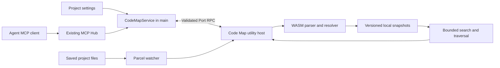

# Code Map design

Everything below is proposed behavior, not an existing API. Read [research](research.md) for the inspected implementation baseline.

## User experience

Add **Project settings → Code Map** with an **Enable Code Map** switch and this explanation:

> Build a local map of saved code so agents can find symbols and dependencies. Updates automatically while Oxytocin is running.

Show state, supported languages, indexed/skipped/error counts, last successful update, cache size, and whether agent access through MCP is available. Provide **Rebuild**, **Pause updates / Resume updates**, **Clear cache**, exclusions, and **Copy agent instructions**. Rebuild is asynchronous and cancellable. The status view must remain useful with MCP disabled; show the existing Agent Tools setup entry point when needed.

States: `disabled`, `indexing`, `ready`, `updating`, `paused`, `degraded`, `error`. `ready` means no known pending changes at the latest checkpoint, not complete semantic knowledge. Parser failures can produce `degraded` coverage with useful results; a missing/unreadable root with no usable graph produces `error`. Display diagnostics without repeated toasts on every edit.

Enabling begins enumeration and indexing; it does not require an agent session. Disabling cancels work, releases watches, denies subsequent map reads for that project, and retains the cache for fast re-enabling. Pause suspends updates but permits explicitly stale reads. Clear cache cancels in-flight work and removes only that project's validated application-owned cache; if enabled and not paused, it then rebuilds. Removing a project evicts its cache and checkout registrations. Changing its root invalidates the old association before indexing the new root.

No global master switch in the first release: project opt-in is sufficient. No automatic changes to `CLAUDE.md`, `AGENTS.md`, `.mcp.json`, or `.gitignore`. New agent sessions receive a short MCP brief; existing sessions discover changes through the existing tool-list mechanism and tool descriptions. Do not assume clients reread initialization instructions dynamically.

The first release offers status and agent tools. A later explorer can show package/file clusters and a selected symbol's neighborhood, with relation/confidence filters and **Open file**. It must use the same queries, limit nodes, and provide a list alternative; never render the entire large graph by default.

## Process ownership



Main owns settings, authorized checkout identities, subscriptions, supervision, and orchestration. The host owns enumeration, filesystem watching, parsing, content hashes, graph assembly, search indexes, and cache I/O. Renderer receives compact status updates and bounded results through the existing validated IPC/preload route. Neither main nor renderer parses code or receives a whole graph.

Use a new `src/code-map-host` with `UtilityHost`, an entry in the Electron build, and explicit ESLint/TypeScript boundaries. Reuse `@parcel/watcher` in this host initially. A separate watch subscription is an intentional first-release cost: sharing the current Git watcher would require generalizing ownership, ignores, event types, and support for Git-disabled projects. Do not create both a new watch feed in Workspace Host and duplicate subscriptions in Code Map Host.

Use one writer per checkout and initially one active build across the host. Prioritize queried/active checkouts, then other enabled projects fairly. Yield between bounded parse batches; use an interruptible worker or terminate/restart the host for a parser exceeding its watchdog. Do not run arbitrary project build scripts or language servers. A parser process is workload isolation, not a complete OS security sandbox.

## Settings and persistence

Proposed optional settings shape:

```ts
codeMap?: {
  enabled: boolean;           // absent means false
  excludedPaths?: string[];  // project-relative glob patterns
}
```

Pause is runtime state in v1; reopening resumes enabled projects and reconciles first. Hard resource limits are internal defaults until measurement justifies user controls. Runtime status and graph data do not belong in `projects.json`. Add schema defaults/migration tests and preserve this field in all project-settings draft/save paths.

Cache location: `<userData>/code-map/<checkoutKey>/`. Main supplies this location. `checkoutKey` is a hash of the canonical real root plus the project's identity; include checkout identity rather than only Git common directory, branch name, or HEAD. Graph symbols use root-relative POSIX paths, while cache identity honors filesystem case rules (including case-sensitive directories on Windows). Do not globally lowercase paths. Resolve junctions/symlinks when establishing containment; do not follow links outside the registered root.

Store immutable generations containing a manifest, per-file extraction data, graph, and retrieval index. The manifest includes schema version, extractor/resolver/grammar versions, settings hash, file hashes, generation ID, and coverage diagnostics. Keep the last good generation while publishing a replacement. Write into a temporary generation directory; validate references/checksums; publish a small current-generation pointer via same-directory temporary write and rename. Readers pin one generation for the full request. On Windows, retry transient rename failures within a bound; preserve the old pointer if publication fails. Startup ignores incomplete generations and rebuilds invalid/version-mismatched data. Retain at most current plus previous generation after readers release them.

Start with JSON and in-memory lookup/adjacency indexes. Avoid storing complete source bodies twice: keep symbol signatures and bounded lexical terms; read excerpts from disk only after verifying their hashes. Disk and memory limits must yield visible partial coverage or a recoverable limit error, never a silently truncated “complete” graph. Cache is regenerable; migrations can discard incompatible snapshots without touching source files.

## Graph model and extraction

| Entity   | Required information                                                                                   |
| -------- | ------------------------------------------------------------------------------------------------------ |
| File     | ID, relative path, language, content hash, byte size, parse state, package/scope ID.                   |
| Symbol   | ID, file ID, kind, name, qualified lexical owner, signature, export state, source span.                |
| Edge     | Source, target or unresolved target descriptor, relation, evidence span, resolution provenance.        |
| Snapshot | Generation, checkout identity, configuration versions, coverage, pending changes, last reconciliation. |

Node IDs derive from relative path, kind, qualified owner/name, and a deterministic duplicate/overload discriminator; no line number as the primary identity. Anonymous nodes may need a location discriminator and may change IDs when edited. IDs are stable enough within unchanged structure, not guaranteed across arbitrary refactors. Cursors include generation; stale IDs return `SYMBOL_NOT_FOUND` or `SNAPSHOT_CHANGED`, not a name-based guess.

Define source locations centrally: 1-based lines and 0-based UTF-16 columns for consumers, with byte offsets retained inside extraction. Convert parser offsets explicitly and test Unicode, CRLF, and BOMs. Do not equate parser byte columns with Monaco/LSP columns.

Initial node kinds: file, function, method, class, interface, type, enum, variable. Relations: `contains`, `imports`, `calls`, `references`, `extends`, `implements`; each extractor advertises actual supported relations. Provenance values: `syntax`, `binding`, `heuristic`, `unresolved`; future semantic enrichment may add `semantic`. These are evidence categories, not calibrated probabilities. Default impact traversal excludes heuristic edges; callers can request them separately.

For TS/JS, implement original extraction rules for declarations, arrow functions, exports, imports, common static calls, and class members. Resolve lexical scope/shadowing and explicit imported bindings first. Support relative imports, extension/index lookup, static re-exports, and local package boundaries. Parse tsconfig path mappings and package metadata as data without executing configuration. Unsupported aliases, dynamic imports, computed property calls, dependency injection, event buses, and runtime dispatch remain unresolved and contribute diagnostics. Do not infer a call just because another file has a unique matching name.

Use bundled, version-pinned WASM runtime/grammars. Never fetch grammars on first use. The implementation spike determines the build asset layout and ABI pairing. Add additional languages only with their extraction/resolution fixtures and honest coverage descriptions.

## Enumeration and update algorithm

1. Register watching before the initial scan and retain events arriving during it. Enumerate saved files, including eligible untracked files. Honor `.gitignore` semantics when available plus Code Map exclusions; non-Git folders must work. Explicitly exclude `.git`, dependencies, generated outputs, binaries, likely secret files such as `.env` and private keys, and app caches. Do not assume `.gitignore` is a complete secret filter. Tests remain indexed but are labeled for ranking.
2. Treat submodules/nested repositories as boundaries in v1; report skipped roots. A project rooted at a package does not silently expand to its parent repository. Unsupported files contribute counts, not fabricated symbol nodes.
3. Coalesce create/update/delete events by path. Initial target: 300 ms quiet debounce with a 2 s maximum scheduling delay; bulk checkout events collapse into reconciliation. These are tuning targets, not measured results.
4. Read/hash affected files; parse only changed content or files invalidated by extractor/config versions. Atomic saves, renames, and deletes must remove old nodes and incoming/outgoing edges. Rename can initially be represented as delete plus create.
5. Assemble all cached extraction records and resolve the graph afresh for the first release. This simpler O(nodes + relation candidates) pass prevents stale cross-file bindings when an export changes. Measure it before implementing reverse-dependency invalidation. “Incremental” here means changed-file parsing, not a promise of sublinear total updates.
6. Track an event sequence at build start/end. Publish a coherent generation; preserve newer pending changes and schedule another update. Read/stat/hash races retry within a bound; continuously changing files are marked partial. A filesystem without atomic snapshots cannot provide a globally instantaneous view.
7. Reconcile on host restart, app resume/focus, branch/index changes, watcher errors/overflow, ignore/config changes, and periodically (initial target: every 60 seconds while enabled). Unknown watch state requires a full reconciliation. Limit active work and avoid repeated full scans for duplicate triggers.

Start with a 2 MiB per-file cap, 50,000 eligible files, 500,000 nodes, 2,000,000 edges, and a 512 MiB serialized cache cap per checkout. These are proposed protective ceilings, not a performance guarantee. Abort allocations before exceeding bounds, report coverage/limit reasons, and let users narrow exclusions. Revisit limits after the benchmark fixture is measured.

## Freshness contract

Before each query, drain known events and perform a serialized metadata reconciliation (coalesce concurrent probes). Hash dirty/new/stat-changed files and periodically audit all content; explicit **Rebuild** always rehashes everything. A fast metadata probe cannot detect every same-size, same-timestamp edit when the watcher misses it. Report verification mode and last full hash audit; never call that a cryptographic proof of current contents.

`freshness: "latest"` is the default: wait for a generation covering observed changes, within a 2 s query-refresh budget. If no such generation is ready, return a typed `INDEX_UPDATING` result with retry guidance, not an empty result. `"allow-stale"` may return the last good generation, explicitly marked stale with pending/unknown state. `"verified"` requests full content-hash reconciliation and may return `INDEX_UPDATING` while that completes. Paused indexes allow only explicit stale reads. No graph ever returns “no matches” when indexing has not completed.

Freshness metadata includes `generation`, `state`, `stale`, `verification` (`metadata` or `content-hash`), `checkedAt`, `lastFullHashAt`, `pendingFiles`, `coverage`, and warnings. `checkedAt` describes a checkpoint, not the instant of receipt by the agent. Before returning source excerpts, revalidate the selected file hash; retry or omit mismatched excerpts with a diagnostic. Cancellation cancels the caller's wait, not another caller's shared build.

## Agent API

Extend the existing MCP tool registry/policy system; add no transport or authentication scheme. List map tools when at least one project has mapping enabled and notify on availability changes. Every call still checks the selected project's settings. Use compact JSON in the existing text content result for v1; do not require a transport upgrade for structured output.

| Proposed tool         | Inputs beyond checkout selection                                                                              | Output                                                                                  |
| --------------------- | ------------------------------------------------------------------------------------------------------------- | --------------------------------------------------------------------------------------- |
| `oxy_code_map_status` | none                                                                                                          | State, coverage, freshness, supported languages, limits.                                |
| `oxy_find_code`       | `query`, optional `pathPrefix`, `limit`, `maxChars`, `freshness`                                              | Ranked files/symbols with signatures, spans, match evidence, optional bounded excerpts. |
| `oxy_file_outline`    | relative `path`, `maxChars`, `freshness`                                                                      | File exports, definitions, imports, source spans.                                       |
| `oxy_code_relations`  | `symbolId` or relative `path`, `direction`, `relations`, `depth`, `includeHeuristic`, `maxChars`, `freshness` | Bounded neighbors and relation evidence; incoming edges provide an impact estimate.     |

Require an explicit `cwd` or `project` for ordinary map queries, unless a validated terminal mapping establishes an unambiguous checkout. Never silently use the active UI project. If `cwd` is explicit, resolve the longest registered containing checkout; reject conflicting explicit `cwd`/`project`. Project selection alone means its main root. Register Ensemble-managed worktrees with the owning project, inherit opt-in/exclusions, but index them independently. Unregistered arbitrary paths cannot trigger indexing.

The main Hub bearer token currently grants broad app tool access: this proposal does not claim per-agent isolation on that endpoint. Keep existing policy checks. For Ensemble, extend the bridge with an explicit allowlist of map tools; derive checkout from the authenticated role/task, not user-provided selectors or a spoofable terminal header. Extend role context if necessary, and reject path escapes. Revocation/removal cancels access and outstanding requests. A tool list alone is not authorization.

Validate all arguments with zod. Proposed bounds: query length 2,000 characters; limit 1–50 (default 8); depth 1–3 (default 1); output 2,000–24,000 characters (default 8,000). Bound visited nodes/edges separately (initially 2,000/5,000). Include `truncated` and refinement guidance; never treat a bounded impact set as exhaustive. Validate output schemas too. Paths are relative, normalized, and rechecked against canonical containment before reads; exclusions also apply to direct outline requests and exports.

Search v1 uses identifier splitting, exact name/path boosts, signature terms, and modest nearby-symbol expansion. Prefer multiple relevant files over many symbols from one file; let `pathPrefix` constrain monorepo packages. Do not implement PageRank until it improves a labeled retrieval corpus. “No matches” suggests ordinary text search; the map must complement access to source.

Copyable agent rule (original wording):

> When Code Map is available, use oxy_find_code with your working directory to locate relevant code. Use oxy_file_outline and oxy_code_relations for structure and likely dependencies. Check freshness, coverage, and resolution evidence; read current source before editing. Missing edges do not prove that code is unused. Fall back to normal search when results are incomplete or unavailable.

Treat source text/comments as untrusted data, never instructions. MCP delivery is local, but snippets placed in an agent's context may be sent to that agent's configured model provider; “local indexing” must not be marketed as a guarantee that agent usage is offline. Log timing/counts/errors without source bodies or bearer tokens. Avoid automatically sending whole graphs or large maps on every prompt.
