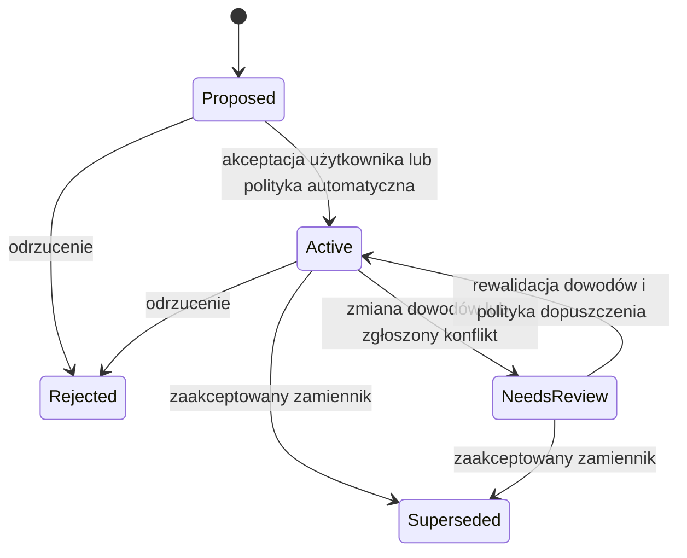

# Etap 12 — learnings: magazyn, walidacja dowodów i menedżer

> Checkpoint 2026-10-20: **in progress**. Main-checkout user manager and storage foundation implemented and tested;
> worktree lifecycle, full project budgets and watcher invalidation remain. See
> [the handoff](results/2026-10-20-learnings-handoff.md). No completion criteria below are marked complete yet.

> Część planu [Code Map](README.md). Przeczytaj `README.md` (sekcje 5.9, 8.2, 8.3, 8.10).

## Cel

Trwały, wersjonowany magazyn learnings w `.oxy/learnings/` z walidacją i unieważnianiem dowodów oraz menedżer
**Learnings** w rdzeniu. Użyteczne **bez agentów**: użytkownik dodaje i przegląda własne learnings. Wydanie samodzielne.

## Wymagania wejściowe

- Etap 10 zrobiony (zmierzona mapa jako punkt odniesienia).

## Zakres

W zakresie: FR-LRN-1, 2 (wpisy użytkownika), 3, 5, 6, 7, 9.

Poza zakresem: narzędzia agentów (etap 13), nakładka w wizualizatorze (etap 14).

## Pełny cykl (dla kontekstu wszystkich etapów 12–14)

1. Użytkownik włącza Code Map i wybiera tryb pamięci. Graf buduje się bez agenta.
2. Na początku pracy agent prosi o kontekst zadania (katalog roboczy, pytanie, opcjonalne kotwice) i dostaje wskaźniki
   kodu, relacje i kilka obowiązujących learnings (etap 13).
3. Agent czyta źródło, edytuje i waliduje zwykłymi narzędziami. Aktywność terminala ani sukces procesu nie są dowodem
   poprawności zadania.
4. Gdy agent odkryje wielokrotnego użytku ograniczenie, decyzję, wniosek z debugowania albo nieudane podejście, zgłasza
   zwięzłą propozycję z dowodami (nie po każdym zadaniu).
5. Serwis waliduje zakres, dowody, budżety, duplikaty i politykę dopuszczania; zapisuje wersjonowany rekord i mówi, czy
   czeka na przegląd, czy może być używany.
6. Późniejsza niezależna sesja dostaje wniosek, gdy pasuje pytanie/kotwice — z pochodzeniem, stanem przeglądu,
   obowiązywaniem i dowodami.
7. Zmiana dowodów, korekta, odrzucenie albo zastępujący wpis usuwa stary rekord ze zwykłego wyszukiwania.

Oxytocin automatyzuje przechowywanie, powiązanie z grafem, sprawdzanie obowiązywania i wyszukiwanie. Treść semantyczną
dostarcza agent (to zużywa jego tokeny). Klient bez learnings nadal korzysta z grafu.

## Model danych

Ustawienia (rozszerzenie `CodeMapSettingsSchema`): `memory?: { mode: 'off' | 'review' | 'automatic' }`; brak → `review`
dla projektów z włączonym Code Map.

| Tryb      | Propozycje                                                                                           | Kontekst zadania                                                                |
| --------- | ---------------------------------------------------------------------------------------------------- | ------------------------------------------------------------------------------- |
| Off       | Zapisy agentów odrzucane; brak przechwytywania w tle.                                                | Tylko kod; istniejące learnings zostają i są dostępne w menedżerze.             |
| Review    | Poprawne propozycje trafiają do kolejki przeglądu.                                                   | Tylko zaakceptowane przez użytkownika i aktualnie obowiązujące.                  |
| Automatic | Kwalifikujące się, zakotwiczone propozycje stają się aktywne bez przeglądu; bez kotwic lub z konfliktem — czekają. | Obowiązujące aktywne, z jawnym odróżnieniem dopuszczenia automatycznego od przeglądu. |

Przełączenie na Review natychmiast wyklucza wpisy dopuszczone automatycznie do czasu przeglądu. Off zatrzymuje odczyty i
zapisy przez narzędzia agentów. Ponowne włączenie ponownie sprawdza obowiązywanie. Wyłączenie Code Map zatrzymuje cały
dostęp agentów do obu warstw.

Rekord (pola wymagane):

| Grupa       | Zawartość                                                                                                                         |
| ----------- | --------------------------------------------------------------------------------------------------------------------------------- |
| Tożsamość   | Nieprzezroczyste ID, wersja schematu, rewizja, znormalizowany klucz deduplikacji, opcjonalny klucz tematu.                         |
| Twierdzenie | Rodzaj (`constraint`, `decision`, `pitfall`, `validation`, `failed-approach`), krótki tytuł, treść, ograniczone uzasadnienie.     |
| Pochodzenie | Projekt/checkout z serwera, znacznik czasu, źródło (`user`/`agent`), rola/zadanie, gdy dostępne, opcjonalna nieweryfikowana etykieta klienta. |
| Zakres      | Domyślnie checkout; zakres projektu tylko po awansie przez użytkownika; kotwice ścieżek/symboli; rewizja Gita, gdy dostępna.      |
| Dowody      | Lokalizatory plików/konfiguracji/dokumentów, hashe liczone przez serwis, opcjonalnie symbol/zakres, opcjonalny wynik walidacji zgłoszony przez agenta. |
| Cykl życia  | Stan dopuszczenia, metadane przeglądu, obowiązywanie per checkout, ostatnie sprawdzenie, ID zamiennika/konfliktu.                  |
| Feedback    | Liczniki użyć i ograniczone referencje feedbacku; nigdy automatyczny „wynik prawdziwości”.                                        |

Pochodzenie, przegląd i obowiązywanie są rozdzielne — bez jednej liczby „confidence”. Logiczny graf wiedzy jest mały:
węzły `learning` i `evidence`; powiązania `applies_to`, `supported_by`, `supersedes`, `conflicts_with`. `applies_to` nie
tworzy krawędzi `calls`/`imports`.

Dowody: plik źródłowy z indeksu albo jawnie nazwany dozwolony dokument/konfiguracja (np. fixture testowy, `package.json`);
sprawdzenie zawierania i wykluczeń, hash ograniczonego tekstu (limit 256 KiB dla dowodów spoza źródła), obserwacja tych
ścieżek. URL-e to tylko etykiety — nigdy nie są pobierane. Polecenia nigdy nie są uruchamiane przez serwis pamięci.

## Dopuszczanie, unieważnianie, korekty

1. Rozwiąż checkout tym samym ścisłym wyborem co narzędzia kodu. Odrzuć wyłączoną pamięć, referencje spoza katalogu/
   wykluczone, zniekształcone wejście, przekroczone budżety — przed zapisem.
2. Pochodzenie ustalaj po stronie serwera; podane przez wołającego autor/sesja/koszt/sukces testów to tylko deklaracje.
3. Przypnij generację kodu i przeczytaj hashe dowodów; zmiana w trakcie walidacji → `EVIDENCE_CHANGED` (nigdy nie
   zatwierdzaj na podstawie hasha wołającego). Odmawiaj dowodów z plików sekretów.
4. Deduplikuj znormalizowane identyczne twierdzenia o tym samym zakresie/kotwicach; honoruj klucze idempotencji;
   ponowienie to nie potwierdzenie.
5. Wykrywaj jawne zastąpienia/konflikty i kolizje tematów; rozbieżne alternatywy czekają (nie rozstrzygaj po czasie,
   popularności ani deklarowanej pewności modelu).
6. Automatic: wymagana ≥ 1 aktualna kotwica w zakresie, brak konfliktu, wolny budżet. To kwalifikacja do wyszukiwania, nie
   weryfikacja twierdzenia. Użytkownik może zaakceptować decyzję architektoniczną bez kotwic z datą przeglądu.

Stany (per checkout dla obowiązywania):

- Odwrotny indeks ścieżka dowodu → learnings; zmiana pliku dowodu unieważnia obowiązywanie przed następnym odczytem
  kontekstu, nawet w trakcie przebudowy struktury. Początkowo hashe całych plików.
- Znikający symbol nigdy nie wiąże się po cichu z innym o tej samej nazwie; zmiana nazwy pliku wymaga jawnego lub
  jednoznacznego przemapowania, inaczej referencja zostaje nierozwiązana.
- Ręcznie zaakceptowane wpisy bez kotwic wygasają do przeglądu po 30 dniach.
- Automatyczna reaktywacja po zmianie dowodów wymaga nowej propozycji/rewizji ze zaktualizowanymi dowodami i jawnym
  potwierdzeniem twierdzenia — samo ponowne przeczytanie pliku nie wystarcza.
- Edycje użytkownika tworzą rewizje; zastąpienie zachowuje historyczne powiązanie do czasu usunięcia. Learnings nigdy nie
  są automatycznie zamieniane na reguły `CLAUDE.md`/`AGENTS.md`.

## Magazyn, współbieżność, worktree

- `.oxy/learnings/learnings.json` (deterministyczny: posortowane rekordy, bez ścieżek maszyny, znaczniki czasu tylko jako
  pola rekordu należące do twierdzenia) i `.oxy/learnings/local/` (liczniki, receipts, kopie odzyskiwania).
- Code Map Host jedynym zapisującym; main dostarcza zwalidowane lokalizacje i autoryzuje operacje.
- Wersjonowany JSON + atomowa zamiana; limit 2000 żywych rekordów / 32 MiB na projekt (z rewizjami); ostatni poprawny
  stan zachowany do odzyskiwania; niekompatybilny schemat to **nie** cache — nieudana migracja zostawia stare dane i
  pamięć niedostępną z błędem do naprawy.
- Mutacje z oczekiwaną rewizją i kluczem idempotencji; konflikt → `REVISION_CONFLICT` (bez last-writer-wins). Zapis przy
  pełnym magazynie odrzucany ze wskazówką przycinania; odczyty działają dalej; żadnej cichej eksmisji przejrzanej wiedzy.
- Wersje grafu kodu i pamięci są osobne.
- Learnings z worktree Ensemble zostają w nim, dopóki użytkownik ich nie awansuje; obowiązywanie liczone osobno w każdym
  checkoutcie; usunięcie worktree zachowuje rekordy do wglądu, ale blokuje wyszukiwanie pod inną tożsamością; merge
  Gita nie łączy learnings.
- Delete/forget przepisuje kopie odzyskiwania i indeksy, żeby usunięta treść nie wróciła po restarcie lub przebudowie;
  tylko tombstony bez treści dla idempotencji. Eksport tylko na żądanie (bez poświadczeń); zewnętrznych eksportów
  aplikacja nie może wymazać.
- **Rebuild** i **Delete map data** nigdy nie ruszają `.oxy/learnings/`; **Forget all learnings** to osobna, potwierdzana
  akcja (FR-LRN-7). Usunięcie projektu mówi jasno, czy lokalne learnings też zostaną usunięte.

## Zadania

1. `src/code-map-host/memory/store.ts` — magazyn, schemat, migracje, atomowość, limity, odzyskiwanie.
2. `src/code-map-host/memory/admission.ts` — sekwencja dopuszczania, deduplikacja, konflikty, idempotencja.
3. `src/code-map-host/memory/applicability.ts` — odwrotny indeks dowodów, unieważnianie, wygasanie.
4. Schematy w `src/shared/domain/code-map.ts` (rekord, tryb, wynik dopuszczenia); RPC hosta `memory:*`; IPC dla
   menedżera.
5. UI: tryb pamięci w zakładce Code Map; menedżer **Learnings** (wyszukiwanie/filtr, szczegóły/dowody, akceptuj, odrzuć,
   edytuj jako nową rewizję, zastąp, usuń, eksportuj, **Forget all learnings**) — w zakładce lub osobnym dialogu; działa
   bez wizualizatora.

## Testy

Macierz (unit + integracja):

| Scenariusz                                                     | Wymagany wynik                                                                                                     |
| -------------------------------------------------------------- | ------------------------------------------------------------------------------------------------------------------ |
| Pamięć brak/off; przełączenie automatic → review → off         | Brak = off dla odczytu w trybie; wpisy auto znikają w review; wyłączenie nie kasuje trwałej wiedzy.               |
| Ta sama propozycja ponowiona; dwóch agentów poprawia jeden wpis | Idempotentne ponowienie zwraca ten sam wynik; konflikt rewizji zapobiega cichemu nadpisaniu.                       |
| Hash dowodu podany przez agenta różni się od dysku             | Serwis liczy i weryfikuje sam; zmiana w trakcie odczytu → jawny błąd.                                             |
| Dowody bez zmian, ale twierdzenie błędne                       | Pochodzenie/dopuszczenie odróżnione od prawdy; test nie twierdzi poprawności z powodu zgodnych hashy.             |
| Plik dowodu zmienia się w trakcie przebudowy struktury         | Obowiązywanie unieważnione przed odczytem `latest`.                                                               |
| Zmiana nazwy/usunięcie, symbol o tej samej nazwie, cofnięcie gałęzi | Bez zgadywanego ponownego wiązania; stare twierdzenia nie wracają po nazwie ani czasie.                       |
| Sprzeczne rekordy / jawne zastąpienie                          | Znane konflikty wykluczone do rozstrzygnięcia; nieprzejrzany zamiennik nie zastępuje przejrzanego.               |
| Wyczyszczenie cache indeksu, aktualizacja gramatyki, uszkodzony snapshot | Trwałe learnings przetrwają; kotwice ponownie sprawdzone.                                               |
| Zabicie hosta w trakcie mutacji/migracji; zniekształcona pamięć | Atomowe odzyskiwanie zachowuje wcześniejszą wiedzę.                                                             |
| Forget/delete, potem restart, eksport, przebudowa cache        | Kopie odzyskiwania/indeksy nie wskrzeszają usuniętej treści.                                                      |
| Referencja do pliku sekretu, wykluczony dokument, proza prompt-injection | Odrzucone gdzie wykluczone; żadnego uruchamiania, instalowania reguł, czytania poświadczeń, pobierania.  |
| Wpis bez kotwic albo URL spoza zakresu                         | Brak automatycznej aktywacji; przejrzane wpisy bez kotwic wygasają.                                               |
| Bardzo duża propozycja/magazyn/strumień feedbacku              | Limity i rate limity; zapisy zawodzą łagodnie, odczyty działają.                                                  |
| Zapauzowany indeks / niedostępna aktualna generacja            | Brak automatycznego dopuszczania wymagającego świeżych dowodów.                                                   |

E2E: tryb pamięci round-trip; dodanie learnings użytkownika z kotwicą → edycja pliku dowodu → stan NeedsReview w
menedżerze → rewalidacja; Forget all z potwierdzeniem; Rebuild nie usuwa learnings.

## Kryteria ukończenia

- [ ] Tryb pamięci, menedżer, przeglądy, dowody, korekty, eksport i usuwanie działają bez pluginu.
- [ ] Odzyskiwanie po awarii, konflikty rewizji, izolacja worktree i semantyka forget zaliczone.
- [ ] Żadnego zbierania transkryptów, automatycznych edycji repozytorium ani wywołań dostawców w tle.
- [ ] `npm run check` + E2E zielone.

## Commity i CHANGELOG

- `feat(code-map): store learnings with evidence in .oxy`
- `feat(code-map): manage learnings in Project settings`

CHANGELOG (`### Added`):

> **Code Map learnings:** keep short, evidence-backed findings about a project in `.oxy/learnings/`. Learnings whose
> evidence changes stop being reused until you revalidate them. Review, edit, export or forget them in the Learnings
> manager. Rebuilding or deleting the map never removes them.
