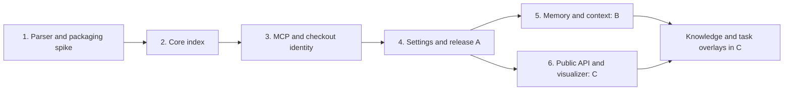

# Code Map implementation plan

This is a future execution brief. The current research task changes documentation only. Re-read root `CLAUDE.md` and inspect current source before implementation; paths below are integration targets, not permission to bypass current architecture.

## Delivery rules

- Implement original code and fixtures; use the upstream research to understand behavior, not as a copying task.
- Work on `main` under repository rules. Do not introduce rollout flags. Per-project opt-in is the requested product behavior.
- Steps 1–4 form **milestone A — structural map**: enable, index, update, query through MCP, inspect status, disable, recover. Step 5 delivers **B — self-learning context**, and step 6 delivers **C — visualizer plugin**. A is independently useful; the requested self-learning product is not complete until B is delivered. Internal preparatory commits may be small, but do not release a visible nonfunctional switch.
- Keep parser and retrieval code outside main, shared contracts free of Node/Electron APIs, and every boundary validated. Every new subscription/job has disposal and cancellation behavior.
- For implementation commits, follow the repository's checks, relevant E2E, build/start, changelog, attribution, and push workflow. Do not add predicted savings to UI copy.

Recommended order is A, B, C so context value is established before visual polish. C's structural views can be built after A; their core query API must not depend on memory being enabled. No calendar estimates are asserted before the packaging and API spikes.

## 1. Prove the parser and package boundary

Dependencies: none. Output: a documented engineering decision and a packaged parser fixture.

- Prototype the pinned WASM runtime and JS/TS/TSX grammars in a utility process. Use original fixtures with imports, shadowing, re-exports, arrow functions, JSX, Unicode, syntax errors, and large files.
- Compare cold start, parse throughput, memory, and bundle size in development and packaged Windows builds, including non-ASCII paths and a machine without a compiler/toolchain. Disable network during the packaged test.
- Audit all shipped grammar/runtime licenses and hashes. Resolve runtime/grammar ABI compatibility and asset lookup in ASAR/resources. Record versions and reproducible grammar generation provenance.
- Decide WASM versus native based on measurements. If WASM misses the targets in [validation](validation.md), first profile extraction and serialization before introducing native modules.
- Define source offset conversion and cache-version inputs. Freeze initial supported syntax and explicitly unresolved forms.

Likely files: `electron.vite.config.ts`, `electron-builder.yml`, `package.json`, lockfile, third-party notices, `src/code-map-host`, build scripts, TypeScript and ESLint boundaries.

Exit: packaged offline fixture passes on Windows; no runtime download, toolchain, or project command execution; no parser work on main. Record actual numbers and remaining gaps.

## 2. Build the deterministic index and lifecycle

Depends on 1. Output: a supervised service with a stable internal query contract.

- Add `src/shared/domain/code-map.ts` schemas and `src/shared/rpc/contracts/code-map-host.ts` for configure/remove/status/query/rebuild/pause and compact status events. Include errors, generation metadata, coverage, and cancellation semantics. Reserve explicit layer/provenance discrimination, without implementing unused memory abstractions in A.
- Add `src/code-map-host/{index,enumerate,watch,scheduler,extract,resolve,store,query}` modules as needed; avoid precreating abstraction layers without callers.
- Add `src/main/services/code-map/code-map-service.ts` to own checkout registrations and host lifecycle. Register through the app's existing service/bootstrap pattern; inspect actual bootstrap location before editing.
- Implement per-file hashed extraction reuse, full relation resolution, immutable snapshot publication, corruption recovery, budgets, and cleanup. Implement watcher-first initialization and event-sequence tracking.
- Use saved working-tree contents, including untracked files, rather than HEAD. Apply ignores, file caps, canonical-path containment, and nested-repository boundaries consistently to enumeration and query paths.
- Implement explicit freshness modes and status/error envelopes. Ensure restart reattaches enabled projects and reconciles before latest queries.

Exit: cold and incremental graphs are equivalent for the same tree; rapid edits/deletes/renames/branch changes produce no dangling edges; restart and interrupted writes recover; non-Git projects and Git-disabled projects work; selected source excerpts never knowingly mismatch their snapshot.

## 3. Connect MCP and every supported checkout context

Depends on 2. Output: agents can discover and use bounded structural context.

- Add a dedicated `src/main/services/mcp/code-map-tools.ts` builder rather than expanding the large core-tools file indefinitely. Inject service dependencies into `mcp-hub.ts`; reuse registry policies and call logs.
- Implement the four tools in [design](design.md), argument/output validation, response budgets, error codes, and cancellation. Add an availability predicate analogous to resource tools without pretending Code Map is a database resource.
- Add a short conditional MCP initialization brief and capability descriptions. Keep the tool descriptions useful for already-connected sessions. Reuse client configuration export; test generic HTTP MCP access without requiring a new CLI installer.
- Implement strict map-specific checkout resolution. Do not globally change existing core tool project-selection behavior as an incidental cleanup.
- Inspect `src/main/services/ensemble/ensemble-service.ts`, `ensemble-tools.ts`, and the Hub bridge. Extend authenticated role context with the actual worktree root/identity where needed. Explicitly bridge read-only map tools and verify no selector can escape that checkout.
- Stop and revoke map access when a project is disabled or a task/worktree disappears. Do not return the main checkout map as a fallback for a missing worktree map.

Exit: tests cover two projects and two divergent worktrees; queries select the requested code even while another project is active; authenticated Ensemble roles cannot query a sibling checkout; disabled maps reject direct calls even if cached tool definitions remain in the client.

## 4. Complete project settings and first-release verification

Depends on 2–3. Output: a complete usable first release.

- Extend `ProjectSettingsSchema`, project-settings draft/patch helpers, and their tests. Update all alternate settings writers so new fields round-trip correctly.
- Add Code Map tab/status UI, progress, coverage and diagnostics, rebuild/pause/cache actions, exclusions, and copyable instructions. Use CSS tokens and existing settings controls. Wire IPC through channels/contracts/router/preload, with sender validation.
- Verify lifecycle when switching projects, restarting the app, changing root, disabling mapping during a query, and disabling MCP while keeping local indexing enabled.
- Run the correctness and packaged smoke matrix in [validation](validation.md), and the repository's `npm run check`, `npm run build`, and relevant Playwright suites. Add feature-specific E2E tests and run existing project-settings, MCP Hub, Ensemble, and host tests affected by the change.
- Update CHANGELOG only for the implemented behavior, dependency notices, user documentation, and the feature status in this directory. Record measured limits and unresolved coverage honestly.

Exit: the acceptance checklist is green; terminal/Git responsiveness remains within measured targets; users can enable, observe, use, and disable the feature without manually modifying their repository.

## 5. Deliver self-learning context (milestone B)

Depends on A. Output: a new session can retrieve a useful finding from an earlier session, with its origin, evidence, and applicability; the user can correct or remove it without the visualizer.

### 5.1 Durable storage and applicability

- Implement the schemas and state machine in [learning and context](learning-and-context.md). Keep derived graph storage separate from durable learning records, revision history, evidence indexes, and optional scope promotion.
- Add host-owned memory store/admission/applicability modules, version checks, atomic mutation, bounded recovery, expected-revision conflicts, idempotency, and capacity handling. Define an explicit migration path; do not reuse discard-and-rebuild cache migration for memory.
- Implement evidence hashing and reverse invalidation for indexed code plus explicitly referenced allowed documents/config files. Test races between graph publication, learning submission, and context reads.
- Keep worktree-local records isolated; user-promoted records get independent applicability in each checkout. Add no automatic learning merge on Git branch/task merge.

Exit: interrupted writes preserve durable knowledge; stale evidence removes eligibility before reuse; cache deletion leaves memory intact; forget removes content from recovery copies and derived indexes; concurrent corrections cannot silently overwrite each other.

### 5.2 Retrieval and write tools

- Add the three B tools with distinct read/write policies and concise discovery. Reuse authentication, cancellation, strict selection, and error handling. Explicitly extend Ensemble's allowlist and derive proposal origin/scope from the authenticated role.
- Implement bounded context assembly with source/memory allocation, relevance reasons, layer-specific provenance, and a pinned code generation/memory revision. Add lexical/anchor memory retrieval before any embedding or graph-ranking experiment.
- Make generic MCP origin metadata honest: neither a session label nor terminal header proves author identity. Bind feedback receipts to the available context and reject expired/cross-checkout references.
- Extend the copyable agent guidance: request context when useful, read source, propose only reusable evidence-backed findings, and report stale/incorrect memory. Do not require one learning per task or force a stop hook.

Exit: two independent client sessions complete query → work → proposal → reuse → changed evidence → suppression/correction; offline fake-client integration is deterministic. Run manual interoperability checks with at least two supported MCP clients and record client versions, discovery behavior, and observed tool use without claiming automatic compliance.

### 5.3 Complete controls and evaluate learning

- Add off/review/automatic preferences with round-trip tests, a basic core Learnings manager, proposal/review details, scope promotion, export, delete/forget, and memory status distinct from index status.
- Give the user a clear explanation of what the selected mode saves and reuses. No transcript collector, model credentials, hidden inference job, or Usage Monitor internal dependency is introduced.
- Run B's adversarial, durability, worktree, and multi-session evaluation matrix. Separate capture cost, retrieval cost, and subsequent-task benefit. Tune admission/relevance using training fixtures, not held-out evaluation tasks.
- Update user documentation and CHANGELOG for actual B behavior. Do not market A alone as self-learning or report reuse counts as tokens saved.

Exit: the B acceptance checklist in [validation](validation.md) passes. If automatic admission fails its quality gate, fix or constrain the policy before shipping automatic mode; review-only memory remains an independently useful outcome but does not satisfy automatic-mode acceptance.

## 6. Deliver the visualizer plugin (milestone C)

Depends on A and stable bounded graph queries. B is required only for knowledge/task-context overlays. Output: an inspectable graph using the public plugin API, with no duplicate index or requirement to keep the panel open.

1. Add graph aggregation/slice operations and verify that every edge/count comes from the selected generation. Freeze hard node/edge/byte caps and generation-change behavior before UI integration.
2. Add `oxy.codeMap`, permission enum/descriptions, facade/main enforcement, subscriptions, cancellation, source navigation, public type declarations, API changelog/version, and capability discovery. Extend documented core navigation commands. Test an unauthorized third-party fixture as well as the built-in plugin.
3. Prototype the rendering candidates in the actual plugin iframe using the [visualizer experiment](visualizer.md#rendering-decision-and-experiment). Record versions, licenses, CSP/offline behavior, and performance; choose one renderer based on results.
4. Create `plugins/code-map-visualizer` using public APIs only. Deliver Overview, Neighborhood, search/filter, checkout selector, evidence detail, source navigation, keyboard/list alternative, truncation/coverage, and stable refresh behavior. Add B overlays when available.
5. Exercise hide/show/dispose, plugin disable/reload, map disable, permission change, rapid project switches, removed worktrees, and late replies. Verify the agent tools still work with the plugin disabled.
6. Add the plugin to the repository's built-in discovery/build/package flow, update manifests/docs/notices, run relevant plugin/E2E checks, and repeat the packaged Windows smoke test.

Exit: C's acceptance checklist passes; one core index serves both MCP and the plugin; source locators remain scoped; large projects produce bounded useful views; no measurable terminal regression outside the stated target.

## 7. Improve based on evidence

Each item is a separate follow-up with its own usable outcome:

| Extension                                              | Start only when                                                                                                                       |
| ------------------------------------------------------ | ------------------------------------------------------------------------------------------------------------------------------------- |
| Python/Go and further languages                        | Real project demand exists and parser/resolver fixtures plus license/packaging checks are ready.                                      |
| Semantic TS/LSP enrichment                             | Measured missed/incorrect relations justify lifecycle and memory cost.                                                                |
| SQLite or incremental relation updates                 | Profiling shows JSON publication/full resolution is the limiting factor.                                                              |
| Static Markdown export or managed instruction adapters | Agent clients demonstrably cannot use the existing MCP flow adequately; export staleness and file ownership are specified.            |
| Graph-aware ranking                                    | Labeled retrieval tests improve beyond the lexical baseline without regressions across scopes.                                        |
| Semantic memory search / embeddings                    | Lexical and anchor retrieval miss useful held-out learnings; quality gains justify model distribution, memory, and indexing cost.     |
| Optional session-summary adapters                      | Clients demonstrably fail to submit useful proposals; data selection, retention, provider cost, and consent are specified separately. |
| Architecture/document synthesis                        | Evidence-linked manual/derived groups are insufficient and generated claims pass correctness and invalidation evaluation.             |
| Team export/import and synchronization                 | Scope, provenance, trust, conflict resolution, and deletion semantics are specified; local-only behavior remains usable.              |

Persistent local learnings and context assembly are required milestone B work, not items in this optional-extension table. Automated transcript mining, hosted collaboration, and autonomous model synthesis remain separate proposals. Optional extensions must not weaken the core freshness, evidence, or worktree contracts.

## Execution checkpoints

| Checkpoint              | Reviewable evidence required before continuing                                                                                        |
| ----------------------- | ------------------------------------------------------------------------------------------------------------------------------------- |
| Parser/storage decision | Packaged parser result, grammar manifest/licenses, measured parse/memory numbers, original resolver fixtures.                         |
| A release               | Structural acceptance, checkout isolation, packaged offline result, agent baseline and A comparison.                                  |
| B release               | Admission/invalidation matrix, crash/delete semantics, two-session demo, longitudinal A versus B comparison including negative cases. |
| C release               | Public API contract/version, permission tests, packaged renderer measurements, source-navigation and accessibility results.           |

Record measurements in a dated results file alongside these documents when implementation begins, with repository revision, machine, client/model versions, fixtures, raw measurement locations, and failed cases. Do not replace proposed targets with invented results. This research change creates no runtime, plugin bundle, or production dependency.
