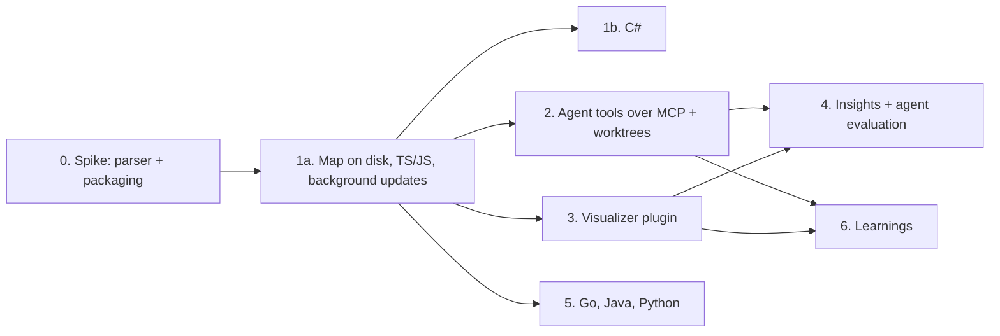

# Code Map implementation plan

Execution plan for the [requirements](requirements.md). It replaces the A/B/C milestone plan of round two (see
[research round three](research-round-3.md) for what changed). Nothing is implemented yet. Before each phase, re-read
`CLAUDE.md`, check the current source against the paths below (they were verified at `cdee9fe`, 0.9.9) and update this
plan if the code has moved.

## Delivery rules

- Work on `main`; Conventional Commits with scope `code-map` (`feat(code-map): …`, `test(code-map): …`); `npm run check`,
  the relevant E2E suites, build and start green before every commit; CHANGELOG `## [Unreleased]` entry for every
  user-visible step; push.
- **No feature flags.** Internal commits that add code without any UI (host, extractor, writer) are allowed because they
  change nothing visible. The Code Map tab appears only in the commit that makes the whole phase-1 loop work.
- Every phase ends in a complete, usable state and can be released on its own.
- Architecture: parsing and file I/O only in the new Code Map host; main orchestrates; renderer and plugins get bounded
  results; zod on every IPC/RPC/file boundary; `Disposable` for every subscription and timer; no sync I/O in main.
- Original code and fixtures. Trail-Code is a behavioural reference only (MIT, attribution kept in the research).
- No savings claims in UI/CHANGELOG before the phase-4 evaluation.

Recommended order: 0 → 1a → 1b → 2 → 3 → 4 → 6, with 5 in parallel whenever capacity allows (it depends only on 1a).
Phases 2 and 3 are independent after 1a and may be swapped; 2 goes first because agent benefit is the primary goal (G1)
and phase 3 reuses phase 2's query engine. Learnings (phase 6, confirmed by the owner) need the MCP tools of phase 2 and
the visualizer of phase 3 for their overlay; running them after phase 4 gives a measured baseline to compare against.

## Phase 0 — parser and packaging spike

Goal: decide the parser runtime with measurements. No product change; the output is a results file
`docs/planned-features/code-map/results/<date>-parser-spike.md` and a prototype script under `scripts/` that is deleted
(or turned into the phase-1 benchmark) afterwards.

Tasks:

1. Prototype `web-tree-sitter` 0.27.1 with the prebuilt WASM grammars shipped in the official npm packages
   ([languages](languages.md#parser-assets-checked-on-npm-2026-10-18)): JavaScript, TypeScript, TSX and C# (phase 1), plus
   a load-and-parse check of Go, Java and Python (phase 5). Run inside an Electron `utilityProcess`, loading `.wasm` files
   from the build output (dev) and from `resources/code-map/grammars/` (packaged).
2. Prototype the TS/JS extraction with the TypeScript compiler API (`ts.createSourceFile`, syntax only) as the fallback for
   TS/JS. C# has no fallback (Roslyn needs a .NET toolchain, which is out of scope), so the C# grammar must pass.
3. Measure on Oxytocin itself and on a generated 10,000-file fixture (`scripts/make-fixtures.ts` can host the generator):
   cold parse throughput, memory, bundle size, startup time; dev and packaged Windows build; offline; path with spaces and
   non-ASCII characters; no compiler toolchain on the machine.
4. Check exact versions, licenses, and the ABI pairing of runtime and each grammar (they were generated by different
   Tree-sitter CLI versions). Build the copy step: grammar packages as devDependencies (their native install scripts are
   not approved in `allowScripts`), `.wasm` copied into `resources/code-map/grammars/` with a `grammars.json` manifest
   (package, version, SHA-256, license) verified at build time, notices generated from the manifest. Measure the load
   time of the 5.35 MB C# grammar and whether grammars should be loaded lazily per language.
5. Decide: Tree-sitter WASM (recommended: required for C# anyway, one framework for every language) or the TS compiler API for TS/JS. Record
   numbers and the decision in the results file.

Exit: a packaged Windows build parses the fixture offline; numbers recorded; decision written down. If WASM misses NFR-1
by more than 2×, profile before switching; if still missing, use the TS compiler API for TS/JS and keep Tree-sitter for
C# and phase 5.

## Phase 1 — map on disk with background updates (releases 1a and 1b)

Phase 1 ships as two releases: **1a** (steps 1.1–1.9, TS/JS) and **1b** (step 1.10, C#).

User-visible result of 1a: in Project settings → Code Map the user enables Code Map; `.oxy/` is created and ignored by Git (by default); the
map builds in the background and stays current; `MAP.md` and `graph.json` are available to every agent; status, pause,
rebuild, delete and copyable agent instructions work. Covers FR-EN, FR-DIR, FR-BLD-1…12 and 14, FR-UPD-1…7, FR-AG-1, FR-AG-6,
FR-ST.

### 1.1 Shared contracts (internal commit)

- `src/shared/domain/code-map.ts` (new): `CodeMapSettingsSchema` (`enabled`, `excludedPaths`), `CodeMapStateSchema`,
  `ignoreInGit` (absent = `true`), `CodeMapStatusSchema` (state, progress, counts, coverage, last update, size, error, owner), `CodeMapGraphSchema` and
  `CodeMapManifestSchema` (the file formats of [oxy-directory](oxy-directory.md)), diagnostics schema.
- `src/shared/domain/project.ts`: `ProjectSettingsSchema.codeMap` optional (absent = disabled).
- `src/shared/rpc/contracts/code-map-host.ts` (new): methods `checkout:configure` (root, mode `project`/`worktree`,
  exclusions, git path), `checkout:remove`, `checkout:rebuild`, `checkout:pause`, `checkout:resume`,
  `checkout:deleteData`, `checkout:status`, `checkout:diagnostics`; events `checkout:status` (compact, throttled to 4/s).
  Query methods are added in phase 2.
- Tests: schema defaults, old `projects.json` without `codeMap` loads, round-trip of graph/manifest fixtures.

### 1.2 Code Map host skeleton (internal commit)

- `src/code-map-host/index.ts`: bootstrap like the other hosts (port RPC, health ping, logging).
- `src/main/hosts/hosts.ts`: `codeMapHost` entry (`HostEntry` union, `Oxytocin Code Map Host`, inspect port 9235),
  started lazily by the service when the first checkout is configured, stopped when none remain.
- `src/main/app/paths.ts` `hostEntry` union, `electron.vite.config.ts` input `codeMapHost`, `eslint.config.mjs` import
  boundaries (host may import `@shared` only), `tsconfig.node.json` include, WASM asset copying (phase-0 layout),
  `electron-builder.yml` (`resources/code-map/*.wasm` or `asarUnpack` per spike result).
- After the host starts, main lowers its priority (`os.setPriority(pid, os.constants.priority.PRIORITY_BELOW_NORMAL)`),
  with a test of the call on the host process handle.
- Tests: `utility-host`-style supervision test (restart, health), packaging test in `scripts/packaging.test.ts` that the
  host bundle and grammars are present.

### 1.3 `.oxy` directory, `.gitignore`, writer (internal commit)

- `src/code-map-host/store/oxy-dir.ts`: create `.oxy/`, `.oxy/.gitignore`, `.oxy/README.md`, `code-map/`; containment
  (real paths, symlink refusal); `owner.lock` with heartbeat and takeover.
- `src/code-map-host/store/gitignore.ts`: pure `ensureOxyIgnored(text): string | null` and
  `removeOxyEntry(text): string | null` (detect existing entry, remove only the exact unchanged block Oxytocin added,
  preserve EOL/BOM/final newline), the `.oxy/.gitignore` content for option on (`*`) and off (machine-local files), and
  the guarded file update; root edits skipped for worktrees and non-Git folders; worktrees always get `*`
  ([oxy-directory](oxy-directory.md#keeping-oxy-out-of-git)).
- `src/code-map-host/store/writer.ts`: atomic temp + rename with Windows retries, publication order, manifest/graph hash
  validation on start, temp cleanup, cache pruning, size accounting.
- `src/workspace-host/git/repo-watcher.ts`: always ignore `.oxy` (next to `ALWAYS_IGNORED_IN_GIT`), independent of
  `git.ignoredFolders`.
- Tests (unit-node): every `.gitignore` case (missing file, CRLF, BOM, no final newline, entry variants, symlink,
  subfolder project, option off, switching off removes only the unchanged block, switching on again), lock takeover, interrupted publication (kill between writes) leaves a readable last good graph,
  `repo-watcher` emits no `fs` refresh for `.oxy` writes.

### 1.4 Enumeration, watching, scheduling (internal commit)

- `src/code-map-host/enumerate.ts`: `git ls-files -z --cached --others --exclude-standard` (with `--no-optional-locks`)
  for Git folders, a gitignore-aware walk for non-Git folders; built-in and user exclusions, secret-name filter, binary
  sniffing (NUL byte in the first 8 KiB), 2 MiB cap; nested repositories/submodules as boundaries; sorted output.
- `src/code-map-host/watch.ts`: `@parcel/watcher` subscription registered **before** the initial scan; events buffered
  with a sequence number; overflow/error → reconciliation.
- `src/code-map-host/scheduler.ts`: debounce 300 ms / max 2 s; periodic reconciliation (60 s active / 10 min inactive /
  30 min full hash audit, FR-UPD-3); triggers for start, focus/resume (`app` events forwarded by main), `.gitignore`/
  `tsconfig`/`package.json`/exclusion changes, HEAD/index changes; one build per checkout; global queue with active
  project first; batch size bounded so health pings stay responsive.
- `src/code-map-host/fingerprint.ts`: stat fingerprint (size, mtime, inode/file id) + SHA-256 content hash.
- Main forwards “active project” and “projects with running terminals” hints (already known to the terminal/activity
  services) to the host.
- Tests: scheduler with fake timers (debounce, max delay, coalescing a 5,000-file branch switch into one pass, no
  rebuild loop when idle), enumeration fixtures (ignored, untracked, nested repo, secrets, binary, large), integration test
  with real filesystem events (`tests/integration/code-map-host.test.ts`).

### 1.5 Extraction and resolution (internal commits, one per concern)

- `src/code-map-host/parse/runtime.ts`: grammar loading and parser pool (from phase 0).
- `src/code-map-host/extract/typescript.ts`: TS/TSX/JS/JSX/MJS/CJS → file record (symbols with spans and signatures,
  imports/exports incl. type-only and re-exports, call sites with callee expressions, heritage clauses). Offsets
  converted to 1-based lines / 0-based UTF-16 columns.
- `src/code-map-host/extract/files.ts`: file-only records for other text files (language from
  `src/shared/utils/language.ts`, line count).
- `src/code-map-host/resolve/modules.ts`: relative paths, extension/`index` lookup, `tsconfig`/`jsconfig` `baseUrl`/
  `paths`/`extends` (parsed as JSONC data), npm workspaces from `package.json`, external packages as `package` nodes.
- `src/code-map-host/resolve/bindings.ts`: lexical scopes and shadowing, imported bindings, `this`/class member calls,
  namespace imports; `heuristic` only for explicitly marked fallbacks; everything else `unresolved` with a reason.
- `src/code-map-host/graph/build.ts`: assemble records → groups, nodes, edges; deterministic IDs and sort; limits.
- Fixtures: `tests/fixtures/code-map/*` small original repositories with expected graphs (`expected.json` reviewed by
  hand), covering shadowing, same-named functions, re-export chains, path aliases, workspaces, CRLF/BOM/Unicode, syntax
  errors, cycles.
- Tests: precision/recall per fixture, **determinism**: shuffled enumeration, cold vs incremental after edits/deletes/
  renames, Windows-style paths and CRLF produce byte-identical `graph.json` (runs on the Windows CI job and the
  `full-tests` matrix).

### 1.6 `MAP.md` (internal commit)

- `src/code-map-host/map-md.ts`: renderer per [oxy-directory](oxy-directory.md#mapmd), budget 32 KiB, whole-line
  truncation, deterministic ranking.
- Tests: golden files for fixtures, budget enforcement, no source bodies/comments, determinism.

### 1.7 Main service and IPC (internal commit)

- `src/main/services/code-map/code-map-service.ts` (new): reads `settings.codeMap` from the project service, configures/
  removes checkouts on enable/disable/root change/project removal, caches status, emits status to the renderer, restarts
  configuration after a host restart, forwards activity hints. Registered in the main bootstrap next to the other
  services.
- IPC: channels in `src/shared/ipc/channels.ts` (`codeMap:getStatus`, `codeMap:rebuild`, `codeMap:pause`,
  `codeMap:resume`, `codeMap:deleteData`, `codeMap:getDiagnostics`, event `codeMap:status`), zod contracts in
  `contract.ts`/`events.ts`, handlers via `src/main/ipc/router.ts`, preload bindings on `window.oxy`.
- Tests: service lifecycle with a fake host (enable → configure, disable → remove, root change, host restart re-sends
  configuration, project removal), IPC validation rejects malformed payloads.

### 1.8 UI (the user-visible commit of phase 1)

- `src/renderer/src/features/projects/ProjectSettingsDialog.tsx`: `code-map` tab; `project-settings-model.ts` draft
  round-trips `codeMap` (tests that saving any other tab keeps it).
- `src/renderer/src/features/projects/settings/CodeMapTab.tsx` (new): switch + confirmation dialog (FR-EN-2) with
  **Keep `.oxy` out of Git** checked by default; the same checkbox in the tab with the warning and removal offer of
  FR-DIR-9; status
  block, progress, coverage, size, MCP availability (from the existing MCP settings), Pause/Resume, Rebuild, Delete map
  data (confirm), exclusions editor, diagnostics list, **Copy agent instructions**, “Open MAP.md” (in Oxytocin's editor).
- `src/renderer/src/features/projects/ProjectItem.tsx`: small status indicator (CSS tokens only), tooltip, click opens the
  tab.
- Project removal dialog: one line that `.oxy/` stays in the folder.
- Copyable instructions (original wording, English):
  > This project has an Oxytocin Code Map. Start by reading `.oxy/code-map/MAP.md` for the layout, entry points and key
  > APIs. Use `.oxy/code-map/graph.json` (or the `oxy_*` Code Map tools when available) to find symbols, imports and
  > callers before broad searches. The map covers saved files and may lag a few seconds; always read current source
  > before editing, and fall back to normal search when the map has no answer.
- E2E `tests/e2e/code-map.spec.ts`: enable on a fixture project → confirmation → `.oxy/` + `.gitignore` entry → Ready →
  `graph.json` has expected symbols → edit + save → graph and `MAP.md` updated → Pause (edit not applied) → Resume
  (applied) → Rebuild → disable (no further updates) → Delete map data. Further tests: non-Git folder (no root
  `.gitignore` created); option unticked on enable (no root entry, `graph.json` visible in `git status`, cache and
  manifest not); switching the option off and on in the tab. Extend the project-settings E2E for round-tripping.
- CHANGELOG (Added): “**Code Map:** enable it in Project settings → Code Map to keep a local, deterministic map of the
  project's code in `.oxy/` (ignored by Git). It updates in the background while Oxytocin runs. Agents can read
  `.oxy/code-map/MAP.md`; copy ready-made agent instructions from the tab. TypeScript and JavaScript symbols; other files
  appear as files.” (Release 1a; 1b adds C#, see 1.10.)

### 1.9 Verification before release

- Performance experiment of [validation](validation.md#performance-experiment) on the 10,000-file fixture and Oxytocin
  itself (NFR-1…6), results in `results/<date>-phase-1.md`.
- Packaged Windows smoke: offline, spaces/non-ASCII path, no toolchain, host starts, grammars load.
- Dogfood on Oxytocin's own repository for at least a few days.

Exit: phase-1 checklist in [validation](validation.md#phase-1-acceptance-checklist) green.

### 1.10 C# (phase 1b, second release)

Owner priority together with TS/JS; shipped as its own release right after 1a so each release stays complete and
reviewable. Rules in [languages](languages.md#c-phase-1).

- `src/code-map-host/extract/csharp.ts`: declarations (namespaces incl. file-scoped, types, members, overload
  discriminators, generics arity, visibility), `using`/`global using`/`using static`/aliases, base lists, declared types,
  `new`/`typeof`/`nameof`/attributes, call sites with receiver expressions.
- `src/code-map-host/resolve/dotnet-projects.ts`: `.csproj`/`.sln`/`.slnx`/`Directory.Build.props` as XML/text data
  (`RootNamespace`, `ImplicitUsings`, `TargetFramework(s)`, `ProjectReference`, `PackageReference`, simple `Compile Remove`
  globs); implicit-usings list per SDK kind, versioned in code.
- `src/code-map-host/resolve/csharp.ts`: namespace lookup order, partial-type merging, declared-type based call binding,
  derived file-to-file `references` edges for the Overview; ambiguity → unresolved.
- Default exclusions `bin/`, `obj/`; `.razor`/`.cshtml`/`.xaml` file-level only.
- `MAP.md`: projects and solutions as sections of the layout; entry points from `OutputType=Exe`, `Program.cs`, ASP.NET
  `Program`/`Startup`.
- Fixtures `tests/fixtures/code-map/csharp-*`: a solution with two projects, `ProjectReference`, file-scoped namespaces,
  partial classes, global and implicit usings, overloads, generics, extension methods (expected unresolved), `#if`.
- Tests: precision/recall, determinism, performance on a generated C# fixture; E2E extension: a C# fixture project shows
  Calls coverage for C# in the tab and its types in `graph.json`.
- CHANGELOG (Added): “**Code Map:** C# support — namespaces, types and members, `using` and project references, and calls
  resolved from declared types.”

## Phase 2 — agent tools over MCP and worktree maps

User-visible result: agents connected to the Oxytocin MCP Hub get five Code Map tools with fresh, bounded answers;
Ensemble/Task worktrees have their own maps; the instruction block can be inserted into `CLAUDE.md`/`AGENTS.md`. Covers
FR-AG-2…8, FR-UPD-8, FR-WT-1…2.

### 2.1 Query engine in the host

- `src/code-map-host/query/search.ts`: in-memory index per checkout (identifier splitting of camelCase/snake_case, path
  segments, signature terms, exact-name/path boosts, test files ranked lower, diversity across files); deterministic
  tie-breaking.
- `src/code-map-host/query/outline.ts`, `query/relations.ts` (bounded BFS with visited caps 2,000 nodes / 5,000 edges,
  provenance filter, direction), `query/repo-map.ts` (`MAP.md` sections for a `pathPrefix`), `query/freshness.ts` (drain
  events, metadata probe, wait ≤ 2 s, `latest` / `allow-stale` / `verified` modes, `INDEX_UPDATING` result).
- Excerpts are read from disk only after re-checking the file hash.
- RPC methods `query:*` in `code-map-host.ts` with cancellation.
- Tests: ranking on labelled fixtures (recall@8), bounds and truncation flags, freshness races (query during build,
  edit right before query), cancellation of one caller does not cancel a shared refresh.

### 2.2 MCP tools

- `src/main/services/mcp/code-map-tools.ts` (new): `oxy_code_map_status`, `oxy_repo_map`, `oxy_find_code`,
  `oxy_file_outline`, `oxy_code_relations` ([design](design.md#agent-api)); zod input/output; character budgets; read-only
  policy; listed only when at least one project has Code Map enabled (tool-list change notification on change); every call
  re-checks that the selected project is enabled.
- `src/main/services/mcp/caller-context.ts`: Code Map-specific strict checkout resolution (terminal mapping → explicit
  `cwd` → explicit `project`; never the active UI project; conflicting selectors rejected).
- `src/main/services/mcp/mcp-hub.ts`: wire the builder; append a short Code Map paragraph to the initialization
  instructions when Code Map is enabled for the caller's project.
- Tests: `code-map-tools.test.ts` (validation, budgets, disabled project denied even with a cached tool list, wrong
  project never answered), extend `tests/integration/mcp-hub.test.ts` with real HTTP calls against a fixture map.

### 2.3 Worktrees

- `src/main/services/ensemble/ensemble-service.ts`: when a worktree is ready (`workspace-ready`) and the project has Code
  Map enabled, configure a `worktree` checkout (no root `.gitignore` edit); remove it when the worktree is removed.
- Ensemble MCP bridge (`ensembleBridgeTools` in `mcp-hub.ts`, `ensemble-tools.ts`): allowlist the read-only Code Map
  tools; the checkout is derived from the authenticated role's worktree, never from caller-supplied selectors.
- Tests: two projects + two divergent worktrees; a role cannot query a sibling checkout; removed worktree → access denied.
- Extend `tests/e2e/ensemble*.spec.ts` with a worktree map check.

### 2.4 Instruction block

- Code Map tab: **Add to CLAUDE.md** / **Add to AGENTS.md** / **Remove** — inserts the instruction text between
  `<!-- oxytocin:code-map:start -->` and `<!-- oxytocin:code-map:end -->` (idempotent; preserves EOL; refuses symlinks
  outside the root). The copyable text now also names the MCP tools.
- Tests: unit tests of the insertion function; E2E click → file contains one block → Remove → file restored.

### 2.5 Release

- CHANGELOG (Added): “**Code Map for agents:** agents connected to Oxytocin's MCP server get `oxy_find_code`,
  `oxy_file_outline`, `oxy_code_relations`, `oxy_repo_map` and `oxy_code_map_status` for projects with Code Map. Answers
  are bounded and say how fresh they are. Task and Ensemble worktrees get their own maps. Add the agent instructions to
  `CLAUDE.md` or `AGENTS.md` with one click.”
- E2E: deterministic fake MCP client (`tests/e2e/code-map.spec.ts`): query → edit → query sees edit → disable → denied.

Exit: phase-2 checklist in [validation](validation.md) green; manual check with Claude Code and Codex CLI recorded
(client versions, whether they discovered and used the tools).

## Phase 3 — Code Map Visualizer plugin

User-visible result: **Code Map** opens as a tab/panel and shows Overview, Neighborhood, File and Search views of the
current map with source navigation. Covers FR-VIS-1…9, FR-VIS-13. Detailed UX in [visualizer](visualizer.md).

### 3.1 Graph slices in the host

- `src/code-map-host/query/slice.ts`: `overview` (folder groups with aggregated `imports` counts, expandable),
  `neighborhood`, `file`; caps 150/300 default, 500/1,000 hard, 512 KiB payload; truncation reasons; every count from the
  same generation; `SNAPSHOT_CHANGED` for expansions of an old generation.
- Tests: aggregated edge counts equal underlying edges, caps, cycles, hubs, determinism of slices.

### 3.2 Public plugin API (plugin API 0.2.0)

- `packages/plugin-api/index.d.ts`: `oxy.codeMap` namespace — `listCheckouts(projectId)`, `status(ref)`,
  `query(request, { signal })` (search / outline / relations / slice), `onDidChange(listener)` (invalidations only),
  `openSource(locator)`; version bump to `0.2.0` and its CHANGELOG.
- `src/shared/domain/plugin.ts`: permission `code-map.read` with description; `src/plugin-host/api.ts` facade and
  `src/main/services/plugins/plugin-host-service.ts` dispatch, both checking the permission and the project's opt-in;
  validated requests/results; cancellation; revocation on disable.
- `docs/plugins/README.md`: document the namespace and permission.
- Tests: unauthorized fixture plugin is rejected; disabled project rejected; outstanding request cancelled on disable.

### 3.3 Renderer spike and plugin

- Measure Cytoscape.js (+ a compound-capable layout such as fcose, if its license passes) against the
  [rendering experiment](visualizer.md#rendering-decision-and-experiment) in the packaged plugin iframe; record versions,
  licenses, CSP/offline behaviour and numbers in `results/<date>-renderer.md`. Sigma.js only if the measurements require
  WebGL.
- `plugins/code-map-visualizer/` (new, `@oxytocin/code-map-visualizer`, id `oxytocin.code-map-visualizer`, engine
  `^0.2.0`, permissions `projects.read`, `code-map.read`): panel `codeMap.view` (`singleton: "project"`,
  `showInAddMenu: true`), command `codeMap.open`; host backend relays bounded requests; view built with
  `@oxytocin/plugin-sdk`, theme tokens, imperative graph updates (no React state per layout tick), list view, details
  panel, search, filters, back/forward, stable positions across refreshes, request sequence + checkout identity to drop
  late replies, layout stopped when hidden.
- Core: “Open Code Map” in the Code Map tab and project context menu calls the plugin command when the plugin is enabled.
- Build/package: built-in plugin discovery, `scripts/build-plugins.ts`, notices.
- E2E `tests/e2e/code-map-visualizer.spec.ts`: open → overview shows fixture folders → search symbol → neighborhood →
  open in editor at the right line → save an edit → view refreshes keeping positions → switch project → disable plugin →
  MCP still answers. Keyboard-only list navigation.
- CHANGELOG (Added): “**Code Map Visualizer:** explore a project's Code Map — folders and their dependencies, a file's
  imports and importers, a symbol's callers and callees — and jump to the code.” Plus the plugin API 0.2.0 entry.

Exit: phase-3 checklist in [validation](validation.md) green, measured terminal impact within NFR-4.

## Phase 4 — insights and evaluation

User-visible result: the visualizer helps review changes; benefits are measured. Covers FR-VIS-10…12, FR-WT-3, success
metrics.

- **Changes overlay:** the plugin combines `oxy.git` status (existing `git.read` permission) with a host query
  `dependents(paths, depth)`; changed files highlighted, potential dependents shaded, list grouped by folder. For Task/
  Ensemble, choose the worktree checkout and compare against its base.
- **Impact view** for a node: incoming relations to depth 3 with “Potential dependents in indexed code” wording.
- **Checkout selector** for active worktrees.
- **Export** of the current view as SVG/PNG (Could).
- **Agent evaluation** ([validation](validation.md#does-it-actually-help-agents)): ≥ 20 tasks, Code Map off vs on, same
  agent/model, three repeats; tune `MAP.md` budget and tool descriptions on training tasks only; publish
  `results/<date>-agent-evaluation.md` including negative cases. Only then may README/CHANGELOG describe measured benefits.

## Phase 5 — Go, Java, Python

The owner asked for further languages “where it is not complicated”. With prebuilt WASM grammars the extraction is small;
Go and Java have explicit module systems, Python reaches the Imports level with simple calls
([languages](languages.md#plan-and-complexity)). Depends only on phase 1a; one release per language, in this order:

1. **Go** — `extract/go.ts`, `resolve/go.ts` (`go.mod`, `go.work`, package = directory, receiver methods); fixtures with
   two modules in a workspace.
2. **Java** — `extract/java.ts`, `resolve/java.ts` (packages, source roots, Maven/Gradle modules read as data, wildcard and
   static imports); fixtures with a multi-module Maven layout.
3. **Python** — `extract/python.ts`, `resolve/python.ts` (package roots, `src/` layout, `pyproject.toml`, relative
   imports, `__all__`); fixtures with a `src/` package and relative imports; UI states “Imports + simple calls”.

Each release: grammar added to `grammars.json` with hash and license, default exclusions, extractor and resolver with
fixtures (precision/recall, determinism), support level shown in the UI and `MAP.md`, packaged offline smoke test,
CHANGELOG line. Rust and PHP follow on demand with the same checklist. No language ships with only file-level nodes
presented as “supported”.

## Phase 6 — learnings (self-learning context)

Confirmed by the owner (Q1). Implements FR-LRN of the [requirements](requirements.md#59-learnings--self-learning-context-fr-lrn)
following [learning and context](learning-and-context.md), with these adjustments from round three:

- Storage in `.oxy/learnings/` ([layout](oxy-directory.md#layout)): `learnings.json` holds durable, versioned records;
  `learnings/local/` holds machine-local state (feedback counters, receipts, recovery copies). **Rebuild** and **Delete map
  data** never touch it; **Forget all learnings** is separate. With **Keep `.oxy` out of Git** off, `learnings.json` can be
  committed and shared; it must therefore be deterministic too (sorted records, no machine paths, timestamps only as
  record fields that belong to the claim).
- Memory mode per project: Off / Review before reuse (default) / Automatic.

Steps, each a usable release:

1. **6a — store and manager.** `src/code-map-host/memory/{store,admission,applicability}.ts`; user-authored learnings,
   evidence hashing and invalidation, state machine, Learnings manager UI in the Code Map tab (or its own dialog),
   export/delete/forget. Usable without agents.
2. **6b — agent tools.** `oxy_task_context`, `oxy_propose_learning`, `oxy_learning_feedback` in a new
   `src/main/services/mcp/code-map-learning-tools.ts`; Ensemble bridge allowlist with role-derived scope; updated
   instruction block (“propose only reusable, evidence-backed findings”).
3. **6c — visualizer overlay.** Knowledge view and task-context receipts in the plugin, behind a new
   `code-map.knowledge.read` permission (plugin API minor bump).
4. **6d — evaluation.** The longitudinal evaluation in [validation](validation.md#longitudinal-learning-evaluation)
   (baseline vs map vs map + learnings), including harmful cases; Automatic mode ships only if it passes its gate.

## Effort and risk overview

No calendar estimate is given before phase 0. Relative size and main risks:

| Phase | Relative size | Main risk                                                    | Gate                                       |
| ----- | ------------- | ------------------------------------------------------------ | ------------------------------------------ |
| 0     | S             | WASM packaging in ASAR / performance                         | Packaged offline parse on Windows          |
| 1a    | XL            | Resolver correctness, determinism, non-interference           | Phase-1 checklist, performance experiment  |
| 1b    | L             | C# namespace/partial/overload resolution without a compiler  | C# fixtures, precision/recall              |
| 2     | M             | Checkout selection, freshness races                          | Two-project/two-worktree isolation tests   |
| 3     | L             | Public API design, rendering dense graphs                    | Renderer experiment, permission tests      |
| 4     | M             | Evaluation effort and honest reporting                       | Published evaluation                       |
| 5     | S–M per language | Language-specific resolution                               | Fixtures per language                      |
| 6     | XL            | Admission and invalidation quality of agent-written learnings | [Learning validation](validation.md#longitudinal-learning-evaluation) |

## Results files

Record every measurement in `docs/planned-features/code-map/results/` with date, repository revision, machine,
Electron/Node versions, fixture, raw numbers and failed cases. Targets in these documents stay targets until a results
file replaces them with measurements.
