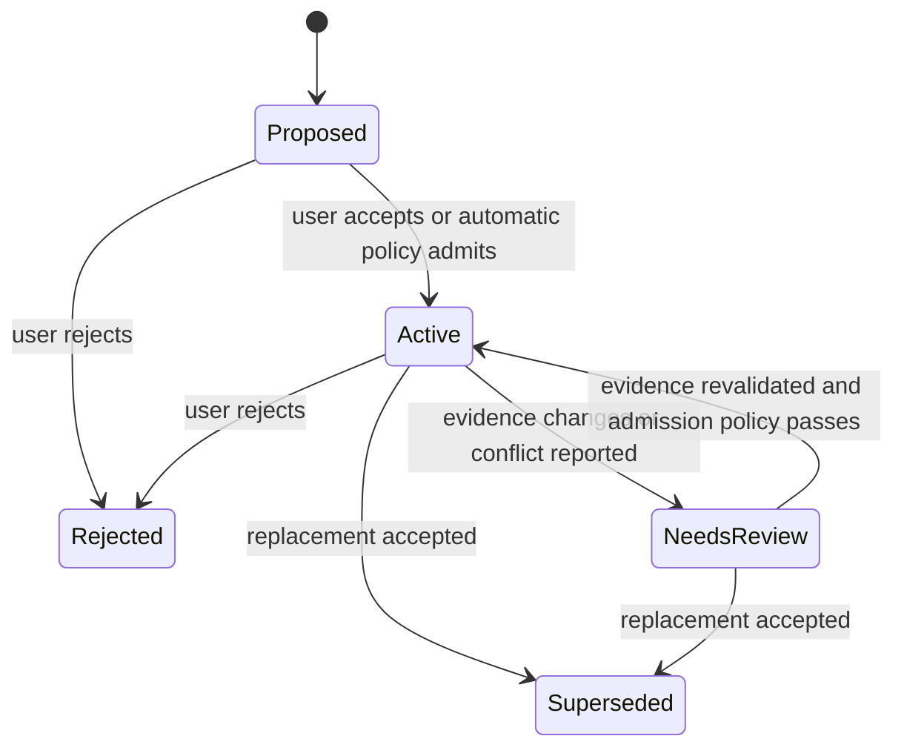

# Learning and task context

> **Status after round three (2026-10-18):** deferred to the optional phase 6 of the [implementation plan](implementation-plan.md), pending owner decision Q1 in the [requirements](requirements.md#11-open-questions-for-the-owner). If implemented, durable records live in `<checkout root>/.oxy/learnings/` instead of `<userData>/code-map-memory/`, next to (never inside) `.oxy/code-map/`, and are never removed by **Rebuild** or **Delete map data**. References below to milestones A and C mean phases 1–2 and 3–4. The rest of this document is kept as the specification for that phase.

Formerly proposed milestone B. The [structural design](design.md) supplies checkout selection, code generations, source spans, and freshness. This document defines durable knowledge and the loop that makes the complete feature self-learning. There is no background model service in this milestone.

## Product behavior and a complete learning loop

1. A user enables Code Map for a project and selects a memory mode. The graph builds from saved files without an agent.
2. At the start of relevant work, an agent requests task context with its working directory, question, and optional file anchors. It receives code pointers, relationships, and a few applicable learnings.
3. During the task, the agent reads source, edits, and validates through its normal tools. Oxytocin does not treat terminal activity or a successful process exit as proof of task correctness.
4. When the agent discovers a reusable constraint, decision, debugging finding, or failed approach, it submits a concise learning proposal with evidence. It need not save a note after every task.
5. The service validates scope, evidence references, budgets, duplicates, and project admission policy. It stores a versioned record and reports whether it is pending review or eligible for reuse.
6. A later independent session retrieves the finding when its question/code anchors match. Retrieval includes origin, review status, applicability, and evidence rather than silently presenting a claim as a source fact.
7. Changed evidence, a correction, explicit rejection, or a superseding entry removes the old record from ordinary retrieval. Validating or reviewing a replacement can restore useful knowledge.

Example: an agent discovers why a plugin's asynchronous view response must include a checkout identity to avoid painting results after a project switch. It saves a short finding anchored to the relevant implementation and regression test. A later task changing view requests receives that finding. If either evidence file changes, the finding needs revalidation; it is not automatically carried forward merely because the title still matches. This is an illustrative task, not a claim that the baseline has this bug.

The application automates storage, graph linkage, applicability checks, and retrieval. The connected agent supplies semantic findings using its current session/model. That work still consumes the agent's tokens. MCP discovery and a copyable instruction encourage the loop but do not guarantee that every client follows it. A graph-only client remains useful; report no captured learnings honestly.

## Settings and user control

Extend the [proposed settings](design.md#settings-and-persistence) in milestone B:

```ts
codeMap?: {
  enabled: boolean;
  excludedPaths?: string[];
  memory?: {
    mode: 'off' | 'review' | 'automatic'; // missing means off
  };
}
```

| Mode      | Proposal behavior                                                                                                            | Default task-context behavior                                                              |
| --------- | ---------------------------------------------------------------------------------------------------------------------------- | ------------------------------------------------------------------------------------------ |
| Off       | Agent writes rejected; no background capture.                                                                                | Code only; existing learnings remain stored and available to the user's management UI.     |
| Review    | Valid proposals enter a review queue.                                                                                        | Only user-accepted, currently applicable entries.                                          |
| Automatic | Eligible anchored proposals can become active without individual review. Unanchored or conflicting proposals remain pending. | Applicable active entries, explicitly distinguishing automatic admission from user review. |

All modes are persistent user preferences, not rollout flags. Switching to review immediately excludes previously auto-admitted entries until reviewed. Switching to off stops learning reads/writes through agent tools. Re-enabling must recheck applicability. Disabling Code Map stops all agent access to both layers.

Provide a basic core **Learnings** manager with search/filter, detail/evidence, accept, reject, edit-as-new-revision, supersede, delete, export, and **Forget all learnings**. Users must be able to inspect and correct memory without installing the visualizer. Review is an optional product workflow selected by the user, not a prerequisite for every automatic learning.

**Clear index cache** and **Forget learnings** are separate operations. Rebuilds and parser upgrades never erase durable knowledge. Project removal follows the existing removal interaction and explicitly states whether local learnings will also be removed; do not silently destroy them as part of cache cleanup. Retained memory becomes inaccessible to agents when its project association is removed. Root relocation requires revalidation against the new root before reuse.

## Knowledge records and graph links

Keep the logical knowledge graph small. Initial node kinds are `learning` and `evidence`; code files/symbols remain in the structural layer. An evidence node is a bounded locator and observation, not a retained transcript. Initial links are `applies_to`, `supported_by`, `supersedes`, and `conflicts_with`. An `applies_to` edge does not create a `calls` or `imports` edge.

Required record fields:

| Field group | Contents                                                                                                                                                                 |
| ----------- | ------------------------------------------------------------------------------------------------------------------------------------------------------------------------ |
| Identity    | Opaque learning ID, schema version, revision, normalized deduplication key, optional topic key.                                                                          |
| Claim       | Kind (`constraint`, `decision`, `pitfall`, `validation`, `failed-approach`), short title, statement, bounded rationale.                                                  |
| Origin      | Host-derived project/checkout, timestamp, source (`user` or `agent`), authenticated role/task where available, optional unverified client/session label.                 |
| Scope       | Checkout-local by default; optional user-promoted project scope; relative path/symbol anchors; observed Git revision where available.                                    |
| Evidence    | File/config/doc locators, file hashes captured by the service, optional symbol/span, and optional agent-reported validation result with command/environment description. |
| Lifecycle   | Admission state, user review metadata, applicability per checkout, last applicability check, optional replacement/conflict IDs.                                          |
| Feedback    | Retrieval/use counters and bounded feedback references; never an automatic truth score.                                                                                  |

Keep **origin**, **review**, and **applicability** separate. For example, an automatically admitted entry can have current source anchors while its interpretation remains an unverified agent claim. A human-accepted entry can become stale. Do not use one numeric “confidence” to collapse these distinctions or invent calibrated probabilities.

Source evidence can reference an indexed source file or an explicitly named allowed repository document/configuration, such as a test fixture or `package.json`. Non-source evidence does not imply full Markdown/config indexing. Verify containment and exclusions, hash bounded text, and watch those evidence paths; use a proposed 256 KiB cap for non-source evidence files. External URLs are labels only in B, never automatically fetched or treated as verified support. A command string is never executed by the memory service.

## Admission, invalidation, and corrections

Proposed admission sequence:

1. Resolve checkout using the same strict selection as code tools. Reject disabled memory, out-of-root/excluded references, malformed input, and over-budget writes before storage.
2. Bind origin server-side. Caller-provided author, session, cost, and test success are claims; the broad Hub token does not establish a distinct trustworthy agent identity. Ensemble supplies a stronger role/task association, not proof that its assertion is true.
3. Pin a code generation and read evidence hashes. If evidence changes during validation, return `EVIDENCE_CHANGED`; do not approve using the caller's hash alone. Refuse known secret-file evidence; heuristic secret detection is supplemental and cannot promise secret-free prose.
4. Deduplicate normalized identical statements with the same scope/anchors, and honor idempotency keys for retried writes. Do not rewrite the original author or count a retry as corroboration.
5. Detect explicit replacement/conflict links and same-topic collisions. Keep alternatives pending if they disagree; do not resolve by newest timestamp, popularity, or a model's self-reported confidence. General semantic contradiction detection is not solved by this baseline.
6. In automatic mode, require at least one current in-scope evidence anchor, no detected conflict, and budget availability for activation. This is eligibility for retrieval, not verification of the claim. Review mode leaves proposals pending; a user can also accept an unanchored architectural decision with a review date.

State model:



Store `NeedsReview` as checkout applicability, separate from the record's admission state, so a shared learning may remain applicable in one checkout and stale in another. The diagram shows the retrieval state of one entry in one checkout. Deletion is available from any state and removes stored content; it is not just another historical state.

Build a reverse index from evidence paths to learnings. A changed evidence file invalidates affected applicability before the next task-context read, even if a structural rebuild is still running. Initially use whole-file hashes for conservative invalidation. Unchanged hash establishes unchanged evidence, not continuing truth of the claim. An anchored symbol disappearing never silently rebinds to a same-named symbol. A file rename requires explicit or unambiguous evidence remapping; otherwise retain the old reference as unresolved.

Unanchored, manually accepted entries expire for review after a proposed 30 days. Referenced dependency/config changes also invalidate their associated records when anchors are present. Feedback saying “used” only affects bounded ranking; a repeated retrieval never revalidates evidence. “Incorrect” or “outdated” feedback suspends ordinary reuse in that checkout and creates a review item; it cannot delete a record or accept a replacement. Record the reporter and support recovery from mistaken reports.

Automatic reactivation after evidence changes requires a new proposal/revision with updated evidence and an explicit reaffirmation of the claim. Merely reading the file again is insufficient. User edits create revisions; superseding a record preserves its historical relationship until the user deletes it. Never automatically convert remembered statements into `AGENTS.md`/`CLAUDE.md` rules or let memory override current instructions.

## Worktrees, concurrency, and storage

Store durable records (round three: under `.oxy/learnings/`, see the status note at the top; originally proposed `<userData>/code-map-memory/<projectId>/`) separately from the structural map. The Code Map host is the single writer; main supplies validated locations and authorizes operations. Start with a versioned JSON state and atomic replacement, bounded to a proposed 2,000 live records / 32 MiB per project, including retained revisions. Preserve the last valid state for crash recovery; do not discard incompatible memory schemas as if they were a regenerable cache. Failed migrations leave the old data intact and memory unavailable with a recoverable error.

Mutations use an expected revision and idempotency key. A conflict returns `REVISION_CONFLICT`; no last-writer-wins overwrites of two agents' corrections. Reject writes at capacity with pruning guidance; keep existing reads usable. Bound history and raw feedback separately; compact counters without removing current claims or audit origin. No silent eviction of user-reviewed knowledge to fit a cap.

The code graph and memory have separate versions. Context responses pin `(checkoutKey, generation, memoryRevision)` and compute applicability against that graph/evidence checkpoint. A subsequent invalidation must not leave a cached context response eligible for a latest read. Do not hold a code-generation reader indefinitely because a plugin has a panel open.

Learnings from an Ensemble worktree stay scoped there until the user explicitly promotes them. A branch name or shared remote URL is insufficient evidence of portability. For project-scoped entries, recompute applicability separately in each registered checkout; missing/different anchors suppress reuse. Removing a worktree preserves its durable records for inspection but prevents retrieval under another checkout identity. Merging Git changes does not automatically merge learnings.

Delete/forget must rewrite retained recovery copies and indexes so deleted content cannot reappear after restart or cache rebuild. Keep at most non-content tombstones needed for idempotency; redact query diagnostics and revoke open context receipts. Export only on user action, with scope/evidence/review metadata and no credentials; exports and external backups cannot be retroactively erased by the application.

## Agent tools and task-context assembly

Keep the four structural tools from [design](design.md#agent-api). Add three tools in B, discoverable only when the selected feature capability is available; actual calls always check current project state:

| Tool                    | Input                                                                                                                              | Result and policy                                                                                                                                                                     |
| ----------------------- | ---------------------------------------------------------------------------------------------------------------------------------- | ------------------------------------------------------------------------------------------------------------------------------------------------------------------------------------- |
| `oxy_task_context`      | Question, optional paths/symbol IDs, checkout selection, `maxChars`, `freshness`.                                                  | Ranked code anchors, a small relationship slice, up to three applicable learnings, evidence, exclusions/warnings, and an opaque receipt. Read-only. Works code-only if memory is off. |
| `oxy_propose_learning`  | Title, kind, statement/rationale, anchors/evidence, optional replacement ID, expected revision, idempotency key.                   | ID/revision, pending/active outcome, applicability and admission reasons. Writes local memory; never marked read-only.                                                                |
| `oxy_learning_feedback` | Receipt, learning ID/revision, outcome (`used`, `irrelevant`, `outdated`, `incorrect`), optional evidence/reason, idempotency key. | Recorded feedback or a review item; cannot approve, delete, or promote scope. Writes local memory.                                                                                    |

Initial bounds: 2,000 question characters; up to eight evidence/anchor references per proposal; 1,500 statement characters plus 1,200 rationale characters; 50 proposals per checkout per hour; 8,000 response characters by default and 24,000 hard maximum, including metadata. Numbers are tuning targets. A too-small budget for required metadata yields `BUDGET_TOO_SMALL`, not invalid/truncated JSON. Result budgets are character limits, not billed-token measurements.

Assembly order:

1. Authorize and reconcile the checkout; resolve explicit anchors and lexical code hits.
2. Expand one hop using supported structural relations within existing visit limits; prefer diversity across relevant files/packages.
3. Retrieve memory candidates by query terms and shared anchors. Exclude wrong-scope, pending, rejected, superseded, conflicting, and stale entries before ranking.
4. Rank by exact anchor match and textual relevance, then bounded recency/use signals. No embedding requirement; no automatic PageRank or semantic inference in B.
5. Allocate a proposed 70% of payload to source pointers/relations and 30% to learnings, after required metadata. Unused allocation can be borrowed. Drop whole low-ranked items to fit; never chop provenance off a retained claim.
6. Return inclusion reasons, relation evidence, freshness/coverage, omitted counts, and refinement suggestions. Empty knowledge is normal. An incomplete index returns an explicit updating/degraded outcome rather than implying there is no related code.

Receipts identify the emitted IDs/revisions, checkout and generation, not a retained prompt or transcript. Keep them in bounded memory for a proposed 30 minutes, bind to the available MCP/role context, and reject unknown, expired, or cross-checkout feedback. This prevents accidental feedback against an unseen revision; it does not create per-agent isolation on the broad-token endpoint. Persistent diagnostics retain counts/timing/error classes only by default.

For C's optional task-context inspection, the user opens a live receipt through a documented core command. A plugin `context-receipt` query can reconstruct the selected items only while the named code generation and memory revisions remain available; otherwise return `SNAPSHOT_CHANGED` or `RECEIPT_EXPIRED`. Do not retain entire old generations for the receipt lifetime or silently rebuild the historical view from current data. The view shows selected IDs, evidence, and inclusion reasons, not the original user prompt. Knowledge items require the additional knowledge permission. Memory disable/delete or checkout revocation also revokes affected receipts.

A proposed compact response shape (field values are illustrative):

```json
{
  "checkoutKey": "checkout-a",
  "generation": "g42",
  "memoryRevision": 17,
  "freshness": { "stale": false, "verification": "metadata" },
  "code": [{ "symbolId": "symbol-a", "path": "src/example.ts", "reason": "exact anchor" }],
  "relations": [],
  "learnings": [
    {
      "id": "learning-1",
      "revision": 2,
      "origin": "agent",
      "review": "automatic",
      "applicability": "current",
      "evidence": [{ "path": "src/example.ts", "hash": "sha256:..." }]
    }
  ],
  "receipt": "opaque-short-lived-id",
  "truncated": false
}
```

The production schema also requires coverage, complete claim text, source spans where applicable, and budget diagnostics. This example illustrates separation of layers, not a complete wire fixture.

## Boundaries of the first learning release

No passive PTY/transcript mining, global cross-project preference memory, automatic user-preference inference, graph-wide summaries, embedding service, hidden model spend, or cloud/team synchronization. An optional future adapter could propose summaries from explicitly selected sessions, but would require its own data access, retention, cost, and evaluation design. Context sent to an agent can reach its configured model provider even though indexing/storage are local.

Project instructions remain the source of operating rules. Learnings are evidence-bearing reference data. The agent reads current source before acting and falls back to ordinary tools when graph coverage or memory relevance is insufficient.
